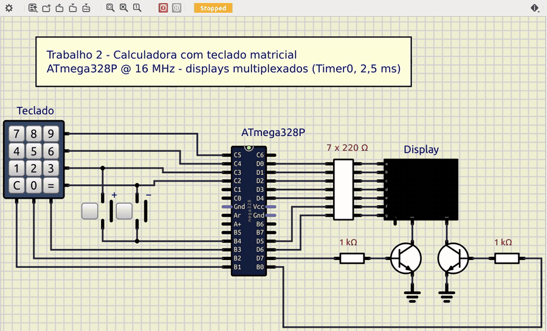

# Calculadora com teclado matricial e displays de 7 segmentos

Trabalho 2 de Microcontroladores (2026/2) · Bernardo Ivo Goltz (202112108)

Calculadora de dois dígitos em assembly do ATmega328P. Lê um teclado matricial 4×4 (0–9, `+`, `−`, `C`, `=`) e mostra os números em dois displays de 7 segmentos multiplexados.



[Circuito SimulIDE](simulide/calculadora.sim1)

## Código

[`src/calculadora.asm`](src/calculadora.asm)

```asm
;==============================================================================
; Trabalho 2 - Calculadora com teclado matricial e 2 displays de 7 segmentos
;
; Microcontrolador : ATmega328P @ 16 MHz
; Montador         : AVR Assembler (Microchip Studio) / avra
;
; Teclado 4x4 (linhas x colunas):
;
;            PB1   PB2   PB3   PB4
;          +-----+-----+-----+-----+
;    PC5   |  7  |  8  |  9  |     |
;    PC4   |  4  |  5  |  6  |     |
;    PC3   |  1  |  2  |  3  |  +  |
;    PC2   |  C  |  0  |  =  |  -  |
;          +-----+-----+-----+-----+
;
; Displays (catodo comum, multiplexados):
;    PD0..PD6 -> segmentos a..g (ativos em 1)
;    PD7      -> catodo do display das dezenas  (via transistor, ativo em 1)
;    PB0      -> catodo do display das unidades (via transistor, ativo em 1)
;
; Funcionamento:
;    - 1o digito digitado aparece como "0d"; o 2o desloca o 1o para a
;      esquerda ("d1d2"). Digitos seguintes continuam deslocando.
;    - "+" ou "-" salva o numero digitado e inicia a leitura do 2o numero.
;    - "=" mostra o resultado. Faixa exibivel: -9 .. 99.
;      Fora da faixa o display mostra "Er".
;    - "C" zera tudo.
;
; Temporizacao:
;    Timer0 em modo CTC gera interrupcao a cada 2,5 ms (400 Hz).
;    A cada interrupcao um display e aceso (200 Hz por display) e o laco
;    principal recebe um tick para varrer o teclado (debounce de 20 ms).
;==============================================================================

.include "m328Pdef.inc"

;------------------------------------------------------------------------------
; Constantes
;------------------------------------------------------------------------------
.equ DIG_DEZ    = 7             ; PD7: habilita display das dezenas
.equ DIG_UNI    = 0             ; PB0: habilita display das unidades
.equ LINHAS     = 0x3C          ; PC2..PC5: linhas do teclado
.equ COLUNAS    = 0x1E          ; PB1..PB4: colunas do teclado

.equ T_SOMA     = 10            ; codigos das teclas de funcao
.equ T_SUB      = 11
.equ T_CLR      = 12
.equ T_IGUAL    = 13
.equ SEM_TECLA  = 0xFF

.equ N_DEBOUNCE = 8             ; 8 x 2,5 ms = 20 ms de leitura estavel

.equ F_NOVO     = 0             ; flag: proximo digito inicia numero novo
.equ F_TRAVA    = 1             ; flag: resultado invalido, ignora operador

.equ SEG_MENOS  = 0x40          ; segmento g
.equ SEG_E      = 0x79          ; a d e f g
.equ SEG_R      = 0x50          ; e g

;------------------------------------------------------------------------------
; Registradores
;------------------------------------------------------------------------------
.def disp_dez = r2              ; padrao de segmentos do display das dezenas
.def disp_uni = r3              ; padrao de segmentos do display das unidades
.def mux      = r4              ; bit 0 indica qual display acender
.def temp     = r16
.def temp2    = r17
.def aux      = r18
.def aux2     = r19
.def atual    = r20             ; numero sendo digitado / exibido (0..99)
.def op1      = r21             ; 1o operando salvo
.def oper     = r22             ; operacao pendente (0, T_SOMA ou T_SUB)
.def flags    = r23
.def cont_deb = r24             ; contador de debounce
.def tecla_ant= r25             ; ultima leitura do teclado

;------------------------------------------------------------------------------
; Vetores de interrupcao
;------------------------------------------------------------------------------
.cseg
.org 0x0000
    rjmp reset
.org OC0Aaddr
    rjmp isr_timer0

.org INT_VECTORS_SIZE

;------------------------------------------------------------------------------
; Inicializacao
;------------------------------------------------------------------------------
reset:
    ldi temp, high(RAMEND)      ; pilha no fim da SRAM
    out SPH, temp
    ldi temp, low(RAMEND)
    out SPL, temp

    ser temp                    ; PD0..PD6 segmentos, PD7 dezenas
    out DDRD, temp
    clr temp
    out PORTD, temp             ; displays apagados

    ldi temp, (1<<DIG_UNI)      ; PB0 saida (unidades), PB1..PB4 entradas
    out DDRB, temp
    ldi temp, COLUNAS
    out PORTB, temp             ; pull-ups nas colunas

    ldi temp, LINHAS            ; PC2..PC5 saidas (linhas do teclado)
    out DDRC, temp
    out PORTC, temp             ; linhas em 1 = nenhuma selecionada

    ldi temp, (1<<WGM01)        ; Timer0 em modo CTC
    out TCCR0A, temp
    ldi temp, 155               ; 16 MHz / 256 / 156 = 400,6 Hz
    out OCR0A, temp
    ldi temp, (1<<CS02)         ; prescaler 256
    out TCCR0B, temp
    ldi temp, (1<<OCIE0A)       ; habilita interrupcao de comparacao A
    sts TIMSK0, temp

    clr mux
    ldi tecla_ant, SEM_TECLA
    ldi cont_deb, N_DEBOUNCE
    rcall limpar
    sei

;------------------------------------------------------------------------------
; Laco principal: espera o proximo tick do Timer0, varre o teclado e
; processa a tecla quando a leitura fica estavel por N_DEBOUNCE ticks.
;------------------------------------------------------------------------------
laco:
    sbis GPIOR0, 0              ; espera o tick sinalizado pela interrupcao
    rjmp laco
    cbi GPIOR0, 0

    rcall varre_teclado         ; temp = codigo da tecla ou SEM_TECLA
    cp temp, tecla_ant
    breq leitura_igual
    mov tecla_ant, temp         ; leitura mudou: reinicia o debounce
    clr cont_deb
    rjmp laco

leitura_igual:
    cpi cont_deb, N_DEBOUNCE    ; ja tratada?
    breq laco
    inc cont_deb
    cpi cont_deb, N_DEBOUNCE
    brne laco
    cpi temp, SEM_TECLA         ; estabilizou em "solta"
    breq laco
    rcall trata_tecla           ; estabilizou em "pressionada"
    rjmp laco

;------------------------------------------------------------------------------
; Interrupcao do Timer0 (2,5 ms): multiplexacao dos displays
;------------------------------------------------------------------------------
isr_timer0:
    push temp
    in temp, SREG
    push temp

    cbi PORTD, DIG_DEZ          ; apaga os dois displays antes de trocar
    cbi PORTB, DIG_UNI

    sbrs mux, 0
    rjmp isr_dezenas
    out PORTD, disp_uni         ; bit 7 = 0: dezenas continuam apagadas
    sbi PORTB, DIG_UNI
    rjmp isr_fim
isr_dezenas:
    out PORTD, disp_dez
    sbi PORTD, DIG_DEZ
isr_fim:
    inc mux
    sbi GPIOR0, 0               ; sinaliza o tick para o laco principal

    pop temp
    out SREG, temp
    pop temp
    reti

;------------------------------------------------------------------------------
; varre_teclado: retorna em temp o codigo da tecla pressionada ou SEM_TECLA
;   Coloca uma linha por vez em 0 (PC5, PC4, PC3, PC2) e le as colunas
;   em PB1..PB4 (0 = tecla pressionada).
;------------------------------------------------------------------------------
varre_teclado:
    ldi temp2, (1<<PC5)         ; bit da linha ativa
    clr aux                     ; indice = linha * 4
varre_linha:
    mov temp, temp2
    com temp
    andi temp, LINHAS
    out PORTC, temp             ; so a linha ativa em 0
    nop                         ; espera o sincronizador da porta
    nop
    in temp, PINB
    com temp                    ; coluna pressionada vira 1
    andi temp, COLUNAS
    brne achou_coluna
    subi aux, -4                ; proxima linha
    lsr temp2
    cpi aux, 16
    brne varre_linha
    ldi temp, SEM_TECLA
    rjmp varre_fim

achou_coluna:
    lsr temp                    ; PB1..PB4 -> bits 0..3
procura_bit:
    sbrc temp, 0
    rjmp coluna_ok
    inc aux
    lsr temp
    rjmp procura_bit
coluna_ok:
    ldi ZH, high(mapa_teclas*2)
    ldi ZL, low(mapa_teclas*2)
    add ZL, aux
    ldi temp, 0
    adc ZH, temp
    lpm temp, Z
varre_fim:
    ldi temp2, LINHAS           ; libera todas as linhas
    out PORTC, temp2
    ret

;------------------------------------------------------------------------------
; trata_tecla: executa a acao da tecla em temp
;------------------------------------------------------------------------------
trata_tecla:
    cpi temp, 10
    brlo tecla_digito
    cpi temp, T_CLR
    breq limpar
    cpi temp, T_IGUAL
    breq tecla_igual

    ; "+" ou "-": salva o 1o operando e prepara a leitura do 2o
    sbrc flags, F_TRAVA
    ret
    mov op1, atual
    mov oper, temp
    sbr flags, (1<<F_NOVO)
    ret

tecla_digito:
    sbrs flags, F_NOVO
    rjmp desloca
    clr atual                   ; comeca um numero novo
    cbr flags, (1<<F_NOVO)|(1<<F_TRAVA)
desloca:
    ; atual = (atual mod 10) * 10 + digito
    mov temp2, atual
    rcall div10                 ; aux = dezenas, temp2 = unidades
    mov aux, temp2
    lsl aux                     ; x2
    mov aux2, aux
    lsl aux                     ; x4
    lsl aux                     ; x8
    add aux, aux2               ; x10
    add aux, temp
    mov atual, aux
    rjmp mostra_numero

;------------------------------------------------------------------------------
; limpar: zera a calculadora e mostra "00"
;------------------------------------------------------------------------------
limpar:
    clr atual
    clr op1
    clr oper
    ldi flags, (1<<F_NOVO)
    rjmp mostra_numero

;------------------------------------------------------------------------------
; tecla_igual: calcula op1 (oper) atual e mostra o resultado
;------------------------------------------------------------------------------
tecla_igual:
    tst oper
    brne calcula
    ret
calcula:
    mov temp, op1
    cpi oper, T_SOMA
    brne subtracao

    add temp, atual             ; soma: 0..198
    cpi temp, 100
    brsh mostra_erro
    mov atual, temp
    rcall mostra_numero
    rjmp igual_fim

subtracao:
    sub temp, atual
    brcs negativo               ; op1 < atual
    mov atual, temp
    rcall mostra_numero
    rjmp igual_fim

negativo:
    neg temp                    ; modulo do resultado
    cpi temp, 10
    brsh mostra_erro            ; abaixo de -9 nao cabe em 2 displays
    rcall segmentos
    mov disp_uni, temp
    ldi temp, SEG_MENOS
    mov disp_dez, temp
    rjmp invalido

mostra_erro:
    ldi temp, SEG_E
    mov disp_dez, temp
    ldi temp, SEG_R
    mov disp_uni, temp
invalido:
    clr atual
    sbr flags, (1<<F_TRAVA)
igual_fim:
    clr oper
    sbr flags, (1<<F_NOVO)
    ret

;------------------------------------------------------------------------------
; mostra_numero: escreve atual (0..99) nos buffers dos displays
;------------------------------------------------------------------------------
mostra_numero:
    mov temp2, atual
    rcall div10
    mov temp, aux
    rcall segmentos
    mov disp_dez, temp
    mov temp, temp2
    rcall segmentos
    mov disp_uni, temp
    ret

;------------------------------------------------------------------------------
; div10: temp2 = temp2 mod 10, aux = temp2 / 10
;------------------------------------------------------------------------------
div10:
    clr aux
div10_laco:
    cpi temp2, 10
    brlo div10_fim
    subi temp2, 10
    inc aux
    rjmp div10_laco
div10_fim:
    ret

;------------------------------------------------------------------------------
; segmentos: converte o digito em temp (0..9) no padrao de 7 segmentos
;------------------------------------------------------------------------------
segmentos:
    ldi ZH, high(tabela_7seg*2)
    ldi ZL, low(tabela_7seg*2)
    add ZL, temp
    ldi temp, 0
    adc ZH, temp
    lpm temp, Z
    ret

;------------------------------------------------------------------------------
; Tabelas em memoria de programa
;------------------------------------------------------------------------------
tabela_7seg:            ;  0     1     2     3     4     5     6     7     8     9
    .db                  0x3F, 0x06, 0x5B, 0x4F, 0x66, 0x6D, 0x7D, 0x07, 0x7F, 0x6F

mapa_teclas:            ; linhas PC5 .. PC2, colunas PB1 .. PB4
    .db 7,     8, 9,       SEM_TECLA
    .db 4,     5, 6,       SEM_TECLA
    .db 1,     2, 3,       T_SOMA
    .db T_CLR, 0, T_IGUAL, T_SUB
```
