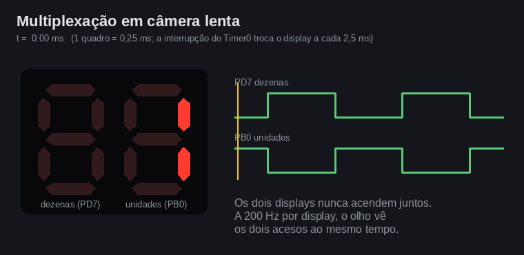
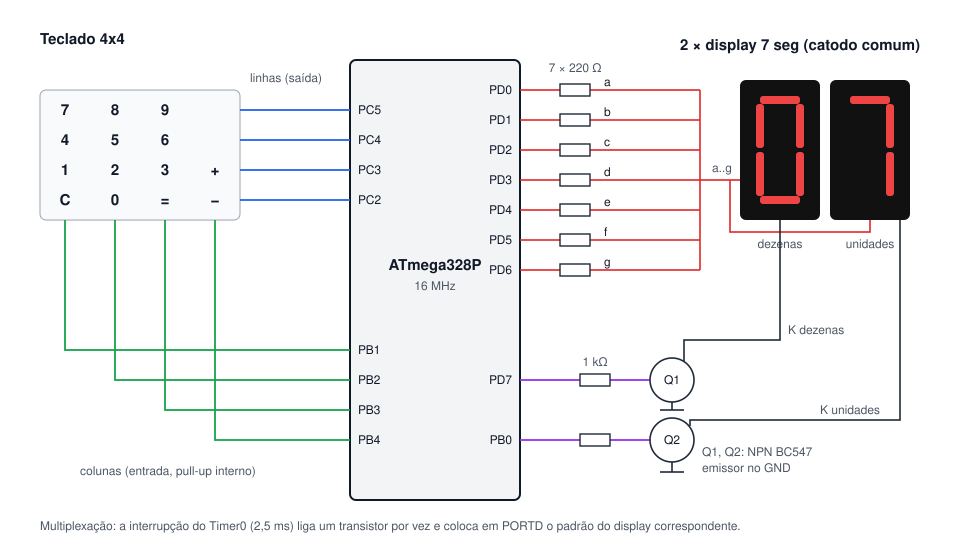
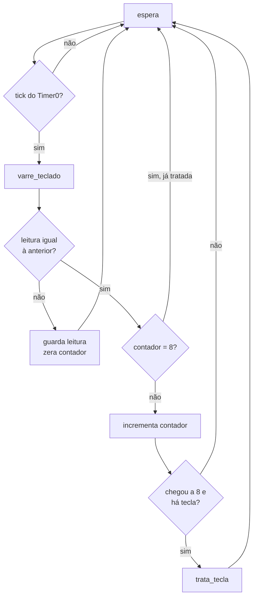
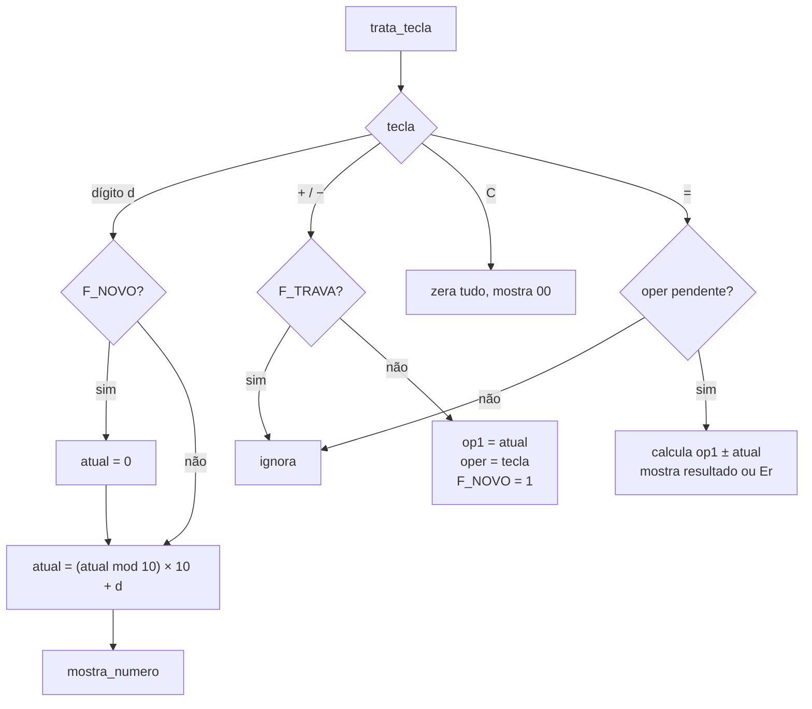

# Calculadora com teclado matricial e displays de 7 segmentos — ATmega328P

Trabalho 2 de Microcontroladores (2026/2).

**Aluno:** _(preencher)_

Calculadora de dois dígitos escrita em **assembly do ATmega328P**. Lê um
teclado matricial 4×4 (dígitos 0–9, `+`, `−`, `C` e `=`) e mostra os números
em **dois displays de 7 segmentos multiplexados**.

## Demonstração


Vídeo: [`docs/simulide.mp4`](docs/simulide.mp4) (GIF acima:
[`docs/simulide.gif`](docs/simulide.gif)). Gravação da tela do
**SimulIDE 1.1** (Linux) rodando o circuito
[`simulide/calculadora.sim1`](simulide/calculadora.sim1) com o binário
[`build/calculadora.hex`](build/calculadora.hex), montado a partir de
[`src/calculadora.asm`](src/calculadora.asm). As teclas são clicadas com o
mouse durante a simulação.

Sequência mostrada:

| Teclas | Display |
|---|---|
| `5` | `05` |
| `5` `3` | `53` |
| `5` `3` `+` `2` `8` `=` | `81` |
| `9` `0` `−` `4` `5` `=` | `45` |
| `1` `2` `−` `1` `5` `=` | `-3` |
| `7` `5` `+` `5` `0` `=` | `Er` (125 não cabe em 2 dígitos) |
| `C` | `00` |

A multiplexação em câmera lenta (cada quadro = 0,25 ms), gerada pelo
simulador do repositório a partir das escritas em `PORTB`/`PORTD`:



## Especificação

- Teclado matricial com os números de 0 a 9 e as teclas Soma, Subtração,
  Clear e Resultado.
- Saída em 2 displays de 7 segmentos, multiplexados.
- Ao digitar o 1º dígito (ex. 5), o display mostra `05`. Ao digitar o 2º
  (ex. 3), o 1º desloca para a esquerda e forma `53`.
- Soma ou Subtração salva o número digitado e inicia a leitura do 2º número.
  Resultado mostra a conta.
- Código em assembly do ATmega328P.

## Hardware



| Componente | Quantidade |
|---|---|
| ATmega328P (16 MHz) ou Arduino Uno | 1 |
| Teclado matricial 4×4 (14 teclas usadas) | 1 |
| Display de 7 segmentos, catodo comum | 2 |
| Resistor 220 Ω (segmentos) | 7 |
| Resistor 1 kΩ (base dos transistores) | 2 |
| Transistor NPN BC547 | 2 |

### Pinagem

| Pino | Direção | Função |
|---|---|---|
| PD0–PD6 | saída | segmentos a–g (nível 1 acende) |
| PD7 | saída | habilita display das dezenas (via Q1) |
| PB0 | saída | habilita display das unidades (via Q2) |
| PC5–PC2 | saída | linhas do teclado (linha ativa em 0) |
| PB1–PB4 | entrada, pull-up | colunas do teclado (tecla pressionada lê 0) |

Os segmentos dos dois displays ficam em paralelo no mesmo barramento
(`PORTD`). Cada display tem o catodo comum ligado a um transistor, então
só acende quando o pino de habilitação correspondente está em 1. Os
transistores evitam passar pelo pino do microcontrolador a corrente de até
7 segmentos acesos.

### Teclado

|        | PB1 | PB2 | PB3 | PB4 |
|---|:-:|:-:|:-:|:-:|
| **PC5** | 7 | 8 | 9 |   |
| **PC4** | 4 | 5 | 6 |   |
| **PC3** | 1 | 2 | 3 | + |
| **PC2** | C | 0 | = | − |

No SimulIDE a matriz é montada com o componente *Teclado* 4×3 (dígitos,
`C` e `=`) mais dois botões (`+` e `−`) formando a 4ª coluna, ligada em
PB4. Eletricamente é a mesma matriz 4×4: cada tecla liga uma linha a uma
coluna. O teclado 4×4 do SimulIDE 1.1 não aceita rótulos personalizados ao
abrir o arquivo, por isso a coluna de funções ficou em botões separados.

## Software

O programa tem duas partes: a **interrupção do Timer0**, que multiplexa os
displays, e o **laço principal**, que varre o teclado e executa a
calculadora.

### Multiplexação (interrupção do Timer0)

O Timer0 roda em modo CTC com prescaler 256:

```
f = 16 MHz / (256 × (OCR0A + 1)) = 16 000 000 / (256 × 156) ≈ 400,6 Hz  →  T ≈ 2,5 ms
```

A cada interrupção a rotina `isr_timer0`:

1. apaga os dois displays (`PD7 = PB0 = 0`), para não aparecer "fantasma"
   do número anterior durante a troca;
2. escreve em `PORTD` o padrão do display da vez (`disp_dez` ou `disp_uni`);
3. liga o display da vez;
4. sinaliza um *tick* no bit 0 de `GPIOR0` para o laço principal.

Cada display fica aceso 2,5 ms e apagado 2,5 ms, ou seja, é atualizado a
200 Hz — rápido o bastante para o olho enxergar os dois acesos ao mesmo
tempo.

### Varredura do teclado e debounce

O laço principal espera o *tick* testando `GPIOR0` (`sbis`/`rjmp`). A
instrução `sleep` não foi usada porque o SimulIDE 1.1 não a implementa por
completo: o núcleo AVR para e não volta na interrupção. A cada *tick* o
laço chama `varre_teclado`, que coloca uma linha por vez em 0
(`PC5`…`PC2`) e lê as colunas em `PINB`. Uma coluna em 0 indica a tecla
pressionada; a posição `linha × 4 + coluna` indexa a tabela `mapa_teclas`
na memória de programa, que devolve o código da tecla (0–9 para dígitos,
10 = `+`, 11 = `−`, 12 = `C`, 13 = `=`).

O debounce exige **8 leituras iguais seguidas (20 ms)** antes de aceitar a
tecla. A ação é executada uma única vez por toque, quando a leitura
estabiliza em "pressionada". Segurar a tecla não repete o dígito.



### Lógica da calculadora

Estado em registradores:

| Registrador | Nome | Conteúdo |
|---|---|---|
| r20 | `atual` | número sendo digitado ou exibido (0–99) |
| r21 | `op1` | 1º operando salvo |
| r22 | `oper` | operação pendente (0, `+` ou `−`) |
| r23 | `flags` | `F_NOVO`: próximo dígito começa número novo; `F_TRAVA`: resultado inválido |
| r2, r3 | `disp_dez`, `disp_uni` | padrões de segmentos lidos pela interrupção |



- **Deslocamento dos dígitos:** `atual = (atual mod 10) × 10 + dígito`. O
  1º dígito 5 dá `05`; o 2º, 3, dá `53`. Um 3º dígito continua deslocando
  (`537` → `37`), o que permite corrigir um número sem apertar `C`.
- **Operador:** `+`/`−` salvam `atual` em `op1`. O display continua
  mostrando o 1º número até o 2º começar a ser digitado.
- **Resultado:** `=` calcula e mostra. O resultado vira o novo `atual`,
  então dá para continuar a conta (`12 + 3 = + 4 =` → `19`). Um dígito
  depois do resultado começa um número novo.
- **Faixa exibível:** com dois displays, o resultado vai de **−9 a 99**.
  Negativos de −1 a −9 aparecem como `-n` (segmento g no display das
  dezenas). Somas acima de 99 ou diferenças abaixo de −9 mostram `Er`.
  Depois de `Er` ou de um resultado negativo os operadores são ignorados
  até digitar um número novo ou apertar `C`.

A multiplicação por 10 usa deslocamentos (`x×8 + x×2`). A separação em
dezenas e unidades (`div10`) usa subtrações sucessivas, suficiente para
valores até 99. A conversão dígito → segmentos lê a tabela `tabela_7seg`
com `lpm`:

| Dígito | 0 | 1 | 2 | 3 | 4 | 5 | 6 | 7 | 8 | 9 | − | E | r |
|---|---|---|---|---|---|---|---|---|---|---|---|---|---|
| `0gfedcba` | 3F | 06 | 5B | 4F | 66 | 6D | 7D | 07 | 7F | 6F | 40 | 79 | 50 |

## Estrutura do repositório

```
.
├── src/calculadora.asm     código-fonte (AVR Assembler)
├── build/calculadora.hex   binário montado
├── simulide/
│   └── calculadora.sim1    circuito do SimulIDE
├── docs/
│   ├── simulide.mp4        vídeo da simulação no SimulIDE
│   ├── simulide.gif        o mesmo vídeo em GIF
│   ├── multiplexacao.gif   multiplexação em câmera lenta
│   └── esquema.svg         esquema de ligação
└── tools/
    ├── avrsim.py           montador + simulador do ATmega328P (subconjunto)
    ├── testes.py           testes automáticos da calculadora
    ├── gera_gif.py         gera docs/multiplexacao.gif
    └── gera_simulide.py    gera simulide/calculadora.sim1
```

## Como montar e gravar

O fonte segue a sintaxe do AVR Assembler da Microchip e usa
`m328Pdef.inc`.

**Microchip Studio:** criar um projeto *AVR Assembler* para o ATmega328P,
substituir o `main.asm` pelo conteúdo de `src/calculadora.asm` e compilar
(F7).

**avra (Linux):**

```sh
avra -I <pasta com m328Pdef.inc> src/calculadora.asm
```

**Gravação em um Arduino Uno** (bootloader):

```sh
avrdude -c arduino -p m328p -P /dev/ttyACM0 -b 115200 -U flash:w:build/calculadora.hex:i
```

Os segmentos a e b usam PD0/PD1 (RX/TX). Durante a gravação esses dois
segmentos podem piscar; depois disso o programa não usa a serial.

## Simulação no SimulIDE

O SimulIDE para Linux está no Flathub:

```sh
flatpak install flathub com.simulide.simulide
flatpak run com.simulide.simulide simulide/calculadora.sim1
```

O circuito carrega o firmware de `../build/calculadora.hex` (caminho
relativo ao `.sim1`). Clique no botão de energia (vermelho, na barra de
ferramentas) para iniciar a simulação e clique nas teclas do teclado e nos
botões `+`/`−`. O circuito do vídeo foi gerado por
`python3 tools/gera_simulide.py`.

## Testes automáticos

`tools/avrsim.py` é um montador e simulador mínimo, feito para este
trabalho. Ele monta o fonte em palavras de máquina (o mesmo `.hex` de
`build/`) e executa o binário decodificando os opcodes, com Timer0,
portas e o teclado modelados. O mesmo `.hex` roda no núcleo AVR do
SimulIDE, como mostra o vídeo. Requer Python 3; as animações precisam do
Pillow.

```sh
python3 tools/avrsim.py      # gera build/calculadora.hex
python3 tools/testes.py      # roda os testes
python3 tools/gera_gif.py    # gera docs/multiplexacao.gif
```

Os testes apertam teclas no simulador (60 ms pressionada, 60 ms solta) e
leem o texto dos displays a partir das escritas em `PORTB`/`PORTD`:

```
OK   (nada)         -> [00] esperado [00]
OK   5              -> [05] esperado [05]
OK   53             -> [53] esperado [53]
OK   537            -> [37] esperado [37]
OK   53+            -> [53] esperado [53]
OK   53+2           -> [02] esperado [02]
OK   53+28          -> [28] esperado [28]
OK   53+28=         -> [81] esperado [81]
OK   90-45=         -> [45] esperado [45]
OK   12-15=         -> [-3] esperado [-3]
OK   10-19=         -> [-9] esperado [-9]
OK   10-20=         -> [Er] esperado [Er]
OK   75+50=         -> [Er] esperado [Er]
OK   99+0=          -> [99] esperado [99]
OK   50+50=         -> [Er] esperado [Er]
OK   7-7=           -> [00] esperado [00]
OK   8+             -> [08] esperado [08]
OK   8+=            -> [16] esperado [16]
OK   12+3=+4=       -> [19] esperado [19]
OK   12+3=5         -> [05] esperado [05]
OK   75+50=+3=      -> [03] esperado [03]
OK   53+28C         -> [00] esperado [00]
OK   53+28C4+4=     -> [08] esperado [08]
OK   =              -> [00] esperado [00]
OK   5==            -> [05] esperado [05]
OK   tecla segurada -> [07] esperado [07]
OK   repique < 20 ms -> [00] esperado [00]

27/27 testes passaram
```

## Código desenvolvido

Arquivo [`src/calculadora.asm`](src/calculadora.asm):

```asm
;==============================================================================
; Trabalho 2 - Calculadora com teclado matricial e 2 displays de 7 segmentos
;
; Microcontrolador : ATmega328P @ 16 MHz
; Montador         : AVR Assembler (Microchip Studio) / avra
;
; Teclado 4x4 (linhas x colunas):
;
;            PB1   PB2   PB3   PB4
;          +-----+-----+-----+-----+
;    PC5   |  7  |  8  |  9  |     |
;    PC4   |  4  |  5  |  6  |     |
;    PC3   |  1  |  2  |  3  |  +  |
;    PC2   |  C  |  0  |  =  |  -  |
;          +-----+-----+-----+-----+
;
; Displays (catodo comum, multiplexados):
;    PD0..PD6 -> segmentos a..g (ativos em 1)
;    PD7      -> catodo do display das dezenas  (via transistor, ativo em 1)
;    PB0      -> catodo do display das unidades (via transistor, ativo em 1)
;
; Funcionamento:
;    - 1o digito digitado aparece como "0d"; o 2o desloca o 1o para a
;      esquerda ("d1d2"). Digitos seguintes continuam deslocando.
;    - "+" ou "-" salva o numero digitado e inicia a leitura do 2o numero.
;    - "=" mostra o resultado. Faixa exibivel: -9 .. 99.
;      Fora da faixa o display mostra "Er".
;    - "C" zera tudo.
;
; Temporizacao:
;    Timer0 em modo CTC gera interrupcao a cada 2,5 ms (400 Hz).
;    A cada interrupcao um display e aceso (200 Hz por display) e o laco
;    principal recebe um tick para varrer o teclado (debounce de 20 ms).
;==============================================================================

.include "m328Pdef.inc"

;------------------------------------------------------------------------------
; Constantes
;------------------------------------------------------------------------------
.equ DIG_DEZ    = 7             ; PD7: habilita display das dezenas
.equ DIG_UNI    = 0             ; PB0: habilita display das unidades
.equ LINHAS     = 0x3C          ; PC2..PC5: linhas do teclado
.equ COLUNAS    = 0x1E          ; PB1..PB4: colunas do teclado

.equ T_SOMA     = 10            ; codigos das teclas de funcao
.equ T_SUB      = 11
.equ T_CLR      = 12
.equ T_IGUAL    = 13
.equ SEM_TECLA  = 0xFF

.equ N_DEBOUNCE = 8             ; 8 x 2,5 ms = 20 ms de leitura estavel

.equ F_NOVO     = 0             ; flag: proximo digito inicia numero novo
.equ F_TRAVA    = 1             ; flag: resultado invalido, ignora operador

.equ SEG_MENOS  = 0x40          ; segmento g
.equ SEG_E      = 0x79          ; a d e f g
.equ SEG_R      = 0x50          ; e g

;------------------------------------------------------------------------------
; Registradores
;------------------------------------------------------------------------------
.def disp_dez = r2              ; padrao de segmentos do display das dezenas
.def disp_uni = r3              ; padrao de segmentos do display das unidades
.def mux      = r4              ; bit 0 indica qual display acender
.def temp     = r16
.def temp2    = r17
.def aux      = r18
.def aux2     = r19
.def atual    = r20             ; numero sendo digitado / exibido (0..99)
.def op1      = r21             ; 1o operando salvo
.def oper     = r22             ; operacao pendente (0, T_SOMA ou T_SUB)
.def flags    = r23
.def cont_deb = r24             ; contador de debounce
.def tecla_ant= r25             ; ultima leitura do teclado

;------------------------------------------------------------------------------
; Vetores de interrupcao
;------------------------------------------------------------------------------
.cseg
.org 0x0000
    rjmp reset
.org OC0Aaddr
    rjmp isr_timer0

.org INT_VECTORS_SIZE

;------------------------------------------------------------------------------
; Inicializacao
;------------------------------------------------------------------------------
reset:
    ldi temp, high(RAMEND)      ; pilha no fim da SRAM
    out SPH, temp
    ldi temp, low(RAMEND)
    out SPL, temp

    ser temp                    ; PD0..PD6 segmentos, PD7 dezenas
    out DDRD, temp
    clr temp
    out PORTD, temp             ; displays apagados

    ldi temp, (1<<DIG_UNI)      ; PB0 saida (unidades), PB1..PB4 entradas
    out DDRB, temp
    ldi temp, COLUNAS
    out PORTB, temp             ; pull-ups nas colunas

    ldi temp, LINHAS            ; PC2..PC5 saidas (linhas do teclado)
    out DDRC, temp
    out PORTC, temp             ; linhas em 1 = nenhuma selecionada

    ldi temp, (1<<WGM01)        ; Timer0 em modo CTC
    out TCCR0A, temp
    ldi temp, 155               ; 16 MHz / 256 / 156 = 400,6 Hz
    out OCR0A, temp
    ldi temp, (1<<CS02)         ; prescaler 256
    out TCCR0B, temp
    ldi temp, (1<<OCIE0A)       ; habilita interrupcao de comparacao A
    sts TIMSK0, temp

    clr mux
    ldi tecla_ant, SEM_TECLA
    ldi cont_deb, N_DEBOUNCE
    rcall limpar
    sei

;------------------------------------------------------------------------------
; Laco principal: espera o proximo tick do Timer0, varre o teclado e
; processa a tecla quando a leitura fica estavel por N_DEBOUNCE ticks.
;------------------------------------------------------------------------------
laco:
    sbis GPIOR0, 0              ; espera o tick sinalizado pela interrupcao
    rjmp laco
    cbi GPIOR0, 0

    rcall varre_teclado         ; temp = codigo da tecla ou SEM_TECLA
    cp temp, tecla_ant
    breq leitura_igual
    mov tecla_ant, temp         ; leitura mudou: reinicia o debounce
    clr cont_deb
    rjmp laco

leitura_igual:
    cpi cont_deb, N_DEBOUNCE    ; ja tratada?
    breq laco
    inc cont_deb
    cpi cont_deb, N_DEBOUNCE
    brne laco
    cpi temp, SEM_TECLA         ; estabilizou em "solta"
    breq laco
    rcall trata_tecla           ; estabilizou em "pressionada"
    rjmp laco

;------------------------------------------------------------------------------
; Interrupcao do Timer0 (2,5 ms): multiplexacao dos displays
;------------------------------------------------------------------------------
isr_timer0:
    push temp
    in temp, SREG
    push temp

    cbi PORTD, DIG_DEZ          ; apaga os dois displays antes de trocar
    cbi PORTB, DIG_UNI

    sbrs mux, 0
    rjmp isr_dezenas
    out PORTD, disp_uni         ; bit 7 = 0: dezenas continuam apagadas
    sbi PORTB, DIG_UNI
    rjmp isr_fim
isr_dezenas:
    out PORTD, disp_dez
    sbi PORTD, DIG_DEZ
isr_fim:
    inc mux
    sbi GPIOR0, 0               ; sinaliza o tick para o laco principal

    pop temp
    out SREG, temp
    pop temp
    reti

;------------------------------------------------------------------------------
; varre_teclado: retorna em temp o codigo da tecla pressionada ou SEM_TECLA
;   Coloca uma linha por vez em 0 (PC5, PC4, PC3, PC2) e le as colunas
;   em PB1..PB4 (0 = tecla pressionada).
;------------------------------------------------------------------------------
varre_teclado:
    ldi temp2, (1<<PC5)         ; bit da linha ativa
    clr aux                     ; indice = linha * 4
varre_linha:
    mov temp, temp2
    com temp
    andi temp, LINHAS
    out PORTC, temp             ; so a linha ativa em 0
    nop                         ; espera o sincronizador da porta
    nop
    in temp, PINB
    com temp                    ; coluna pressionada vira 1
    andi temp, COLUNAS
    brne achou_coluna
    subi aux, -4                ; proxima linha
    lsr temp2
    cpi aux, 16
    brne varre_linha
    ldi temp, SEM_TECLA
    rjmp varre_fim

achou_coluna:
    lsr temp                    ; PB1..PB4 -> bits 0..3
procura_bit:
    sbrc temp, 0
    rjmp coluna_ok
    inc aux
    lsr temp
    rjmp procura_bit
coluna_ok:
    ldi ZH, high(mapa_teclas*2)
    ldi ZL, low(mapa_teclas*2)
    add ZL, aux
    ldi temp, 0
    adc ZH, temp
    lpm temp, Z
varre_fim:
    ldi temp2, LINHAS           ; libera todas as linhas
    out PORTC, temp2
    ret

;------------------------------------------------------------------------------
; trata_tecla: executa a acao da tecla em temp
;------------------------------------------------------------------------------
trata_tecla:
    cpi temp, 10
    brlo tecla_digito
    cpi temp, T_CLR
    breq limpar
    cpi temp, T_IGUAL
    breq tecla_igual

    ; "+" ou "-": salva o 1o operando e prepara a leitura do 2o
    sbrc flags, F_TRAVA
    ret
    mov op1, atual
    mov oper, temp
    sbr flags, (1<<F_NOVO)
    ret

tecla_digito:
    sbrs flags, F_NOVO
    rjmp desloca
    clr atual                   ; comeca um numero novo
    cbr flags, (1<<F_NOVO)|(1<<F_TRAVA)
desloca:
    ; atual = (atual mod 10) * 10 + digito
    mov temp2, atual
    rcall div10                 ; aux = dezenas, temp2 = unidades
    mov aux, temp2
    lsl aux                     ; x2
    mov aux2, aux
    lsl aux                     ; x4
    lsl aux                     ; x8
    add aux, aux2               ; x10
    add aux, temp
    mov atual, aux
    rjmp mostra_numero

;------------------------------------------------------------------------------
; limpar: zera a calculadora e mostra "00"
;------------------------------------------------------------------------------
limpar:
    clr atual
    clr op1
    clr oper
    ldi flags, (1<<F_NOVO)
    rjmp mostra_numero

;------------------------------------------------------------------------------
; tecla_igual: calcula op1 (oper) atual e mostra o resultado
;------------------------------------------------------------------------------
tecla_igual:
    tst oper
    brne calcula
    ret
calcula:
    mov temp, op1
    cpi oper, T_SOMA
    brne subtracao

    add temp, atual             ; soma: 0..198
    cpi temp, 100
    brsh mostra_erro
    mov atual, temp
    rcall mostra_numero
    rjmp igual_fim

subtracao:
    sub temp, atual
    brcs negativo               ; op1 < atual
    mov atual, temp
    rcall mostra_numero
    rjmp igual_fim

negativo:
    neg temp                    ; modulo do resultado
    cpi temp, 10
    brsh mostra_erro            ; abaixo de -9 nao cabe em 2 displays
    rcall segmentos
    mov disp_uni, temp
    ldi temp, SEG_MENOS
    mov disp_dez, temp
    rjmp invalido

mostra_erro:
    ldi temp, SEG_E
    mov disp_dez, temp
    ldi temp, SEG_R
    mov disp_uni, temp
invalido:
    clr atual
    sbr flags, (1<<F_TRAVA)
igual_fim:
    clr oper
    sbr flags, (1<<F_NOVO)
    ret

;------------------------------------------------------------------------------
; mostra_numero: escreve atual (0..99) nos buffers dos displays
;------------------------------------------------------------------------------
mostra_numero:
    mov temp2, atual
    rcall div10
    mov temp, aux
    rcall segmentos
    mov disp_dez, temp
    mov temp, temp2
    rcall segmentos
    mov disp_uni, temp
    ret

;------------------------------------------------------------------------------
; div10: temp2 = temp2 mod 10, aux = temp2 / 10
;------------------------------------------------------------------------------
div10:
    clr aux
div10_laco:
    cpi temp2, 10
    brlo div10_fim
    subi temp2, 10
    inc aux
    rjmp div10_laco
div10_fim:
    ret

;------------------------------------------------------------------------------
; segmentos: converte o digito em temp (0..9) no padrao de 7 segmentos
;------------------------------------------------------------------------------
segmentos:
    ldi ZH, high(tabela_7seg*2)
    ldi ZL, low(tabela_7seg*2)
    add ZL, temp
    ldi temp, 0
    adc ZH, temp
    lpm temp, Z
    ret

;------------------------------------------------------------------------------
; Tabelas em memoria de programa
;------------------------------------------------------------------------------
tabela_7seg:            ;  0     1     2     3     4     5     6     7     8     9
    .db                  0x3F, 0x06, 0x5B, 0x4F, 0x66, 0x6D, 0x7D, 0x07, 0x7F, 0x6F

mapa_teclas:            ; linhas PC5 .. PC2, colunas PB1 .. PB4
    .db 7,     8, 9,       SEM_TECLA
    .db 4,     5, 6,       SEM_TECLA
    .db 1,     2, 3,       T_SOMA
    .db T_CLR, 0, T_IGUAL, T_SUB
```
