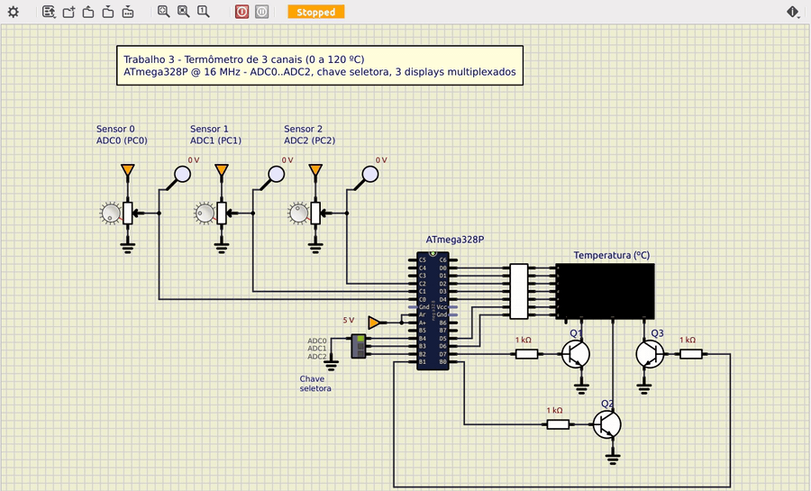

# Termômetro de 3 canais com ADC e displays multiplexados

Trabalho 3 de Microcontroladores (2026/2) · Bernardo Ivo Goltz (202112108)

Termômetro em assembly do ATmega328P. Lê três sensores em ADC0–ADC2 (0 ºC a 120 ºC), escolhe o canal por uma chave seletora e mostra a temperatura em 3 displays de 7 segmentos multiplexados.



[Circuito SimulIDE](simulide/termometro.sim1)

## Código

[`src/termometro.asm`](src/termometro.asm)

```asm
;==============================================================================
; Trabalho 3 - Termometro de 3 canais com ADC e 3 displays multiplexados
;
; Microcontrolador : ATmega328P @ 16 MHz
; Montador         : AVR Assembler (Microchip Studio) / avra
;
; Entradas analogicas (referencia AVcc = 5 V, 10 bits):
;    PC0 (ADC0), PC1 (ADC1), PC2 (ADC2) -> sensores de temperatura
;    0 ADC = 0 C ... 1023 ADC = 120 C
;
; Chave seletora (3 posicoes, uma chave por canal, fechada = 0):
;    PB4 -> ADC0    PB3 -> ADC1    PB2 -> ADC2    (pull-ups internos)
;    Nenhuma ou mais de uma fechada: combinacao invalida, display "---".
;
; Displays (catodo comum, multiplexados):
;    PD0..PD6 -> segmentos a..g (ativos em 1)
;    PD7      -> catodo do display das centenas (via transistor, ativo em 1)
;    PB0      -> catodo do display das dezenas  (via transistor, ativo em 1)
;    PB1      -> catodo do display das unidades (via transistor, ativo em 1)
;
; Funcionamento:
;    - A cada 50 ms le a chave, converte o canal escolhido e mostra a
;      temperatura em graus Celsius, de "  0" a "120".
;    - Conversao: T = (ADC * 120 + 511) / 1023, arredondada para o inteiro
;      mais proximo (multiplicacao 16x8 com MUL e divisao 24/16 bits por
;      deslocamentos e subtracoes).
;    - Zeros a esquerda apagados: 5 C aparece como "  5", 25 C como " 25".
;
; Temporizacao:
;    Timer0 em modo CTC gera interrupcao a cada 2 ms (500 Hz). A cada
;    interrupcao um display e aceso (166,7 Hz por display) e o laco
;    principal recebe um tick; 25 ticks = 50 ms entre leituras.
;==============================================================================

.include "m328Pdef.inc"

;------------------------------------------------------------------------------
; Constantes
;------------------------------------------------------------------------------
.equ DIG_CEN    = 7             ; PD7: habilita display das centenas
.equ DIG_DEZ    = 0             ; PB0: habilita display das dezenas
.equ DIG_UNI    = 1             ; PB1: habilita display das unidades
.equ CH_ADC0    = 4             ; PB4: chave do canal ADC0
.equ CH_ADC1    = 3             ; PB3: chave do canal ADC1
.equ CH_ADC2    = 2             ; PB2: chave do canal ADC2
.equ CHAVES     = (1<<CH_ADC0)|(1<<CH_ADC1)|(1<<CH_ADC2)
.equ SEM_CANAL  = 0xFF

.equ N_LEITURA  = 25            ; 25 x 2 ms = 50 ms entre leituras

.equ T_MAX      = 120           ; temperatura com ADC no fundo de escala
.equ ADC_MAX    = 1023          ; fundo de escala do ADC de 10 bits
.equ MEIO       = ADC_MAX / 2   ; 511: soma antes de dividir = arredonda

.equ SEG_MENOS  = 0x40          ; segmento g
.equ SEG_APAGA  = 0x00

;------------------------------------------------------------------------------
; Registradores
;------------------------------------------------------------------------------
.def disp_cen = r2              ; padrao de segmentos do display das centenas
.def disp_dez = r3              ; padrao de segmentos do display das dezenas
.def disp_uni = r4              ; padrao de segmentos do display das unidades
.def mux      = r5              ; display da vez: 0, 1 ou 2
.def n0       = r6              ; dividendo / quotiente de 24 bits
.def n1       = r7
.def n2       = r8
.def resto_l  = r9              ; resto de 16 bits da divisao
.def resto_h  = r10
.def div_l    = r11             ; divisor de 16 bits (1023)
.def div_h    = r12
.def temp     = r16
.def temp2    = r17
.def aux      = r18
.def cont     = r19             ; contador de bits da divisao
.def cont_lei = r20             ; ticks ate a proxima leitura
.def nov_uni  = r21             ; padroes novos, copiados juntos para os
.def nov_cen  = r22             ; buffers da interrupcao
.def nov_dez  = r23
.def adc_l    = r24             ; leitura do ADC (0..1023)
.def adc_h    = r25

;------------------------------------------------------------------------------
; Vetores de interrupcao
;------------------------------------------------------------------------------
.cseg
.org 0x0000
    rjmp reset
.org OC0Aaddr
    rjmp isr_timer0

.org INT_VECTORS_SIZE

;------------------------------------------------------------------------------
; Inicializacao
;------------------------------------------------------------------------------
reset:
    ldi temp, high(RAMEND)      ; pilha no fim da SRAM
    out SPH, temp
    ldi temp, low(RAMEND)
    out SPL, temp

    ser temp                    ; PD0..PD6 segmentos, PD7 centenas
    out DDRD, temp
    clr temp
    out PORTD, temp             ; displays apagados

    ldi temp, (1<<DIG_DEZ)|(1<<DIG_UNI)
    out DDRB, temp              ; PB0, PB1 saidas; PB2..PB4 entradas
    ldi temp, CHAVES
    out PORTB, temp             ; pull-ups nas chaves

    clr temp                    ; PC0..PC2 entradas analogicas, sem pull-up
    out DDRC, temp
    out PORTC, temp
    ldi temp, (1<<ADC0D)|(1<<ADC1D)|(1<<ADC2D)
    sts DIDR0, temp             ; desliga o buffer digital dos pinos do ADC

    ldi temp, (1<<REFS0)        ; referencia AVcc, resultado alinhado a direita
    sts ADMUX, temp
    ldi temp, (1<<ADEN)|(1<<ADPS2)|(1<<ADPS1)|(1<<ADPS0)
    sts ADCSRA, temp            ; ADC ligado, 16 MHz / 128 = 125 kHz

    ldi temp, (1<<WGM01)        ; Timer0 em modo CTC
    out TCCR0A, temp
    ldi temp, 124               ; 16 MHz / 256 / 125 = 500 Hz (2 ms)
    out OCR0A, temp
    ldi temp, (1<<CS02)         ; prescaler 256
    out TCCR0B, temp
    ldi temp, (1<<OCIE0A)       ; habilita interrupcao de comparacao A
    sts TIMSK0, temp

    clr mux
    clr disp_cen
    clr disp_dez
    clr disp_uni
    ldi cont_lei, 1             ; primeira leitura ja no primeiro tick
    sei

;------------------------------------------------------------------------------
; Laco principal: espera o tick do Timer0 e, a cada N_LEITURA ticks, le a
; chave, converte o canal escolhido e atualiza os displays.
;------------------------------------------------------------------------------
laco:
    sbis GPIOR0, 0              ; espera o tick sinalizado pela interrupcao
    rjmp laco
    cbi GPIOR0, 0

    dec cont_lei
    brne laco
    ldi cont_lei, N_LEITURA

    rcall le_chave              ; temp = canal (0..2) ou SEM_CANAL
    cpi temp, SEM_CANAL
    breq canal_invalido
    rcall le_adc                ; adc_h:adc_l = leitura do canal
    rcall converte              ; temp = temperatura (0..120)
    rcall mostra_numero
    rjmp laco

canal_invalido:
    ldi nov_cen, SEG_MENOS      ; "---"
    ldi nov_dez, SEG_MENOS
    ldi nov_uni, SEG_MENOS
    rcall grava_displays
    rjmp laco

;------------------------------------------------------------------------------
; Interrupcao do Timer0 (2 ms): multiplexacao dos 3 displays
;------------------------------------------------------------------------------
isr_timer0:
    push temp
    in temp, SREG
    push temp

    cbi PORTD, DIG_CEN          ; apaga os tres displays antes de trocar
    cbi PORTB, DIG_DEZ
    cbi PORTB, DIG_UNI

    mov temp, mux
    cpi temp, 1
    breq isr_dezenas
    cpi temp, 2
    breq isr_unidades
    out PORTD, disp_cen         ; mux = 0: centenas
    sbi PORTD, DIG_CEN
    rjmp isr_proximo
isr_dezenas:
    out PORTD, disp_dez         ; bit 7 = 0: centenas continuam apagadas
    sbi PORTB, DIG_DEZ
    rjmp isr_proximo
isr_unidades:
    out PORTD, disp_uni
    sbi PORTB, DIG_UNI
isr_proximo:
    inc mux                     ; 0 -> 1 -> 2 -> 0
    mov temp, mux
    cpi temp, 3
    brlo isr_fim
    clr mux
isr_fim:
    sbi GPIOR0, 0               ; sinaliza o tick para o laco principal

    pop temp
    out SREG, temp
    pop temp
    reti

;------------------------------------------------------------------------------
; le_chave: temp = canal selecionado (0, 1, 2) ou SEM_CANAL
;   Exatamente uma chave fechada (pino em 0) escolhe o canal. Nenhuma ou
;   mais de uma fechada e combinacao invalida.
;------------------------------------------------------------------------------
le_chave:
    in temp, PINB
    com temp                    ; chave fechada vira 1
    andi temp, CHAVES
    cpi temp, (1<<CH_ADC0)
    breq chave_0
    cpi temp, (1<<CH_ADC1)
    breq chave_1
    cpi temp, (1<<CH_ADC2)
    breq chave_2
    ldi temp, SEM_CANAL
    ret
chave_0:
    ldi temp, 0
    ret
chave_1:
    ldi temp, 1
    ret
chave_2:
    ldi temp, 2
    ret

;------------------------------------------------------------------------------
; le_adc: converte o canal em temp e devolve o resultado em adc_h:adc_l
;------------------------------------------------------------------------------
le_adc:
    ori temp, (1<<REFS0)        ; AVcc + canal (MUX3..0)
    sts ADMUX, temp
    lds temp, ADCSRA
    ori temp, (1<<ADSC)         ; inicia a conversao
    sts ADCSRA, temp
le_adc_espera:
    lds temp, ADCSRA            ; ADSC volta a 0 no fim (13 ciclos de ADC)
    sbrc temp, ADSC
    rjmp le_adc_espera
    lds adc_l, ADCL             ; ADCL primeiro: trava ADCH ate ser lido
    lds adc_h, ADCH
    ret

;------------------------------------------------------------------------------
; converte: temp = (adc_h:adc_l * T_MAX + MEIO) / ADC_MAX
;   1) n2:n1:n0 = ADC * 120   (multiplicacao 16x8 com duas MUL)
;   2) n2:n1:n0 += 511        (arredonda para o inteiro mais proximo)
;   3) n2:n1:n0 /= 1023       (divisao 24/16 bits, 24 passos de
;                              deslocamento e subtracao)
;------------------------------------------------------------------------------
converte:
    ldi temp, T_MAX
    mul adc_l, temp             ; r1:r0 = ADCL * 120
    mov n0, r0
    mov n1, r1
    mul adc_h, temp             ; r1:r0 = ADCH * 120 (peso 256)
    clr n2
    add n1, r0
    adc n2, r1

    ldi temp, low(MEIO)
    add n0, temp
    ldi temp, high(MEIO)
    adc n1, temp
    clr temp
    adc n2, temp

    ldi temp, low(ADC_MAX)
    mov div_l, temp
    ldi temp, high(ADC_MAX)
    mov div_h, temp
    clr resto_l
    clr resto_h
    ldi cont, 24
div_laco:
    lsl n0                      ; resto:n desloca 1 bit para a esquerda
    rol n1
    rol n2
    rol resto_l
    rol resto_h
    brcs div_subtrai            ; resto passou de 16 bits: cabe o divisor
    cp resto_l, div_l
    cpc resto_h, div_h
    brlo div_proximo            ; resto < divisor: bit do quociente = 0
div_subtrai:
    sub resto_l, div_l
    sbc resto_h, div_h
    inc n0                      ; bit do quociente = 1
div_proximo:
    dec cont
    brne div_laco

    mov temp, n0                ; quociente <= 120 cabe em n0
    clr r1
    ret

;------------------------------------------------------------------------------
; mostra_numero: escreve temp (0..199) nos buffers, apagando zeros a esquerda
;------------------------------------------------------------------------------
mostra_numero:
    clr aux                     ; aux = centenas
    cpi temp, 100
    brlo mostra_dez
    subi temp, 100
    inc aux
mostra_dez:
    clr temp2                   ; temp2 = dezenas, temp = unidades
mostra_dez_laco:
    cpi temp, 10
    brlo mostra_seg
    subi temp, 10
    inc temp2
    rjmp mostra_dez_laco
mostra_seg:
    rcall segmentos
    mov nov_uni, temp           ; unidades sempre aparecem (inclusive "0")
    ldi nov_cen, SEG_APAGA
    ldi nov_dez, SEG_APAGA
    tst aux
    breq mostra_sem_cen
    mov temp, aux
    rcall segmentos
    mov nov_cen, temp
    rjmp mostra_dezena          ; com centena a dezena aparece mesmo se 0
mostra_sem_cen:
    tst temp2
    breq grava_displays         ; abaixo de 10: so as unidades
mostra_dezena:
    mov temp, temp2
    rcall segmentos
    mov nov_dez, temp

;------------------------------------------------------------------------------
; grava_displays: copia os padroes novos para os buffers da interrupcao
;   com as interrupcoes desligadas, para nao misturar leituras.
;------------------------------------------------------------------------------
grava_displays:
    cli
    mov disp_cen, nov_cen
    mov disp_dez, nov_dez
    mov disp_uni, nov_uni
    sei
    ret

;------------------------------------------------------------------------------
; segmentos: converte o digito em temp (0..9) no padrao de 7 segmentos
;------------------------------------------------------------------------------
segmentos:
    ldi ZH, high(tabela_7seg*2)
    ldi ZL, low(tabela_7seg*2)
    add ZL, temp
    ldi temp, 0
    adc ZH, temp
    lpm temp, Z
    ret

;------------------------------------------------------------------------------
; Tabela em memoria de programa
;------------------------------------------------------------------------------
tabela_7seg:            ;  0     1     2     3     4     5     6     7     8     9
    .db                  0x3F, 0x06, 0x5B, 0x4F, 0x66, 0x6D, 0x7D, 0x07, 0x7F, 0x6F
```
