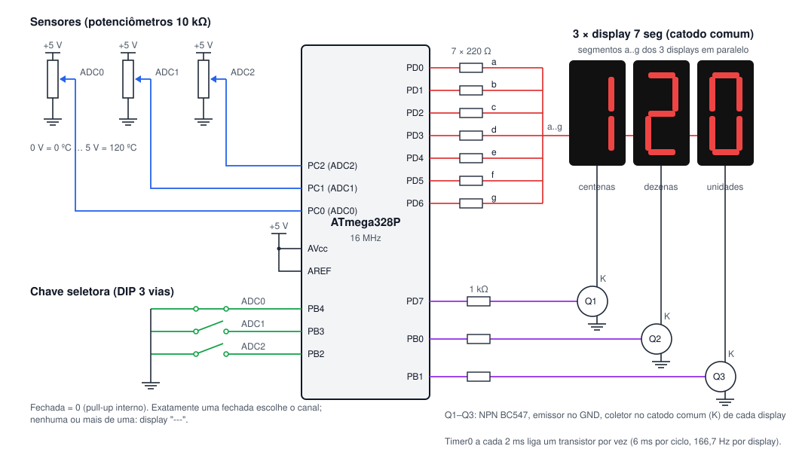
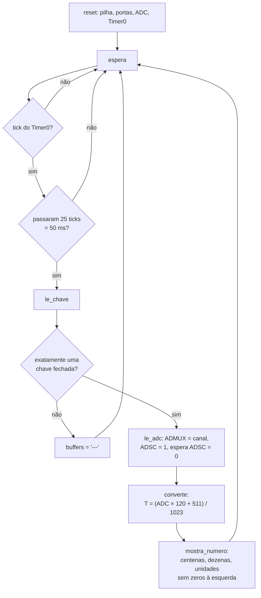
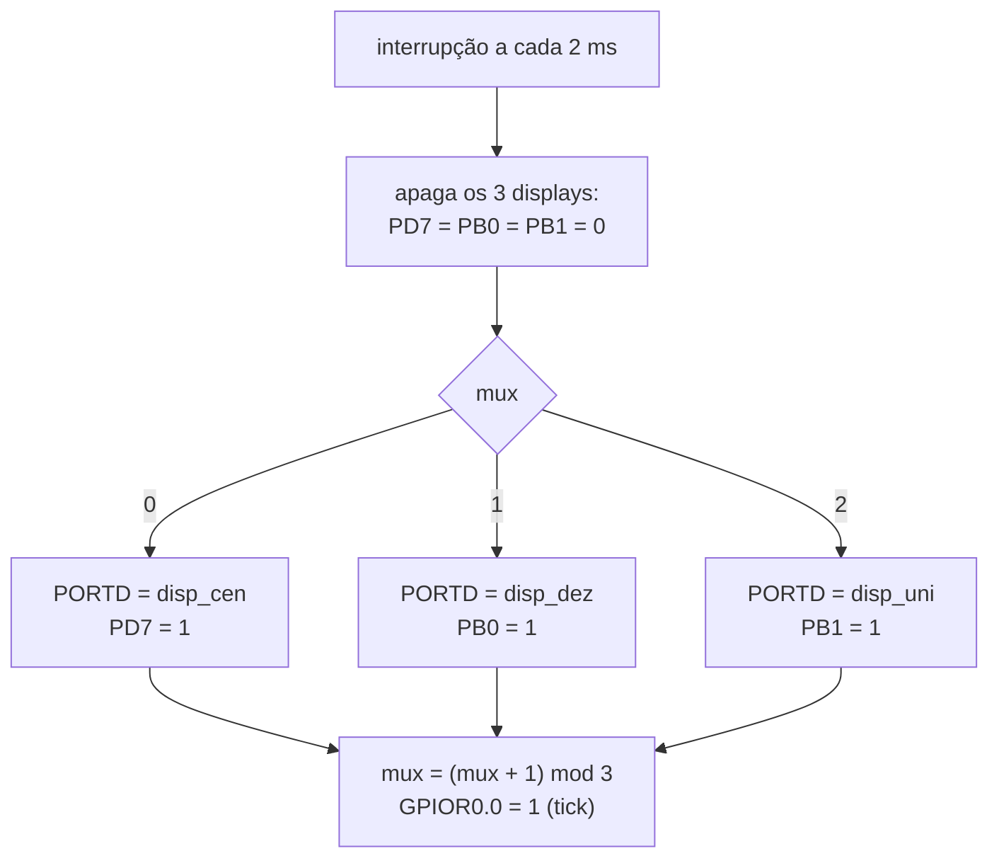
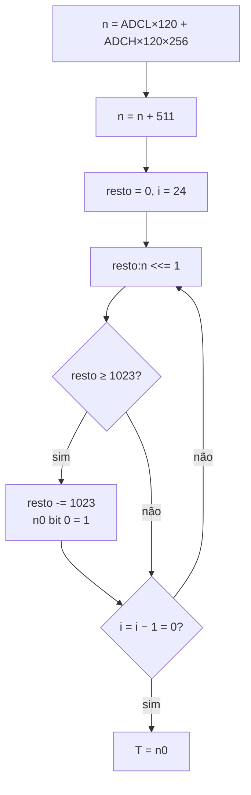

# Termômetro de 3 canais com ADC e displays multiplexados — ATmega328P

Trabalho 3 de Microcontroladores (2026/2).

**Dupla:**

| Nome | Matrícula |
|---|---|
| _(preencher)_ | _(preencher)_ |
| _(preencher)_ | _(preencher)_ |

**Vídeo da apresentação:** _(colocar o link aqui)_ — cópia local em
[`docs/simulide.mp4`](docs/simulide.mp4).

## Objetivo

O microcontrolador lê 3 temperaturas ligadas nos conversores **ADC0, ADC1 e
ADC2**. A escala vai de **0 ºC (ADC = 0) a 120 ºC (ADC = 1023)**. Uma
**chave seletora** escolhe o canal, e o valor em ºC aparece em **3 displays
de 7 segmentos multiplexados**. O código é em assembly do ATmega328P e o
circuito roda no **SimulIDE**.

## Demonstração


Gravação da tela do **SimulIDE 1.1** (Linux) rodando o circuito
[`simulide/termometro.sim1`](simulide/termometro.sim1) com o binário
[`build/termometro.hex`](build/termometro.hex), montado a partir de
[`src/termometro.asm`](src/termometro.asm). Cada sensor é um potenciômetro,
girado com o mouse durante a simulação. Uma ponta de prova em cada canal
mostra a tensão no pino, para conferir a conta.

Sequência do vídeo (valores conferidos quadro a quadro):

| Vídeo | Ação | Tensão no canal | ADC (V × 1024 / 5) | Display |
|---|---|---|---|---|
| 0:05 | chave em ADC0 | 1,25 V | 256 | ` 30` |
| 0:09 | gira o sensor 0 até o fim | 0 V | 0 | `  0` |
| 0:16 | gira o sensor 0 até o máximo (o display sobe junto) | 5 V | 1023 | `120` |
| 0:21 | volta o sensor 0 | 1 V | 204 | ` 24` |
| 0:24 | chave em ADC1 | 2,5 V | 512 | ` 60` |
| 0:28 | gira o sensor 1 | 4,64 V | 950 | `111` |
| 0:31 | chave em ADC2 | 3,75 V | 768 | ` 90` |
| 0:36 | gira o sensor 2 | 0,14 V | 28 | `  3` |
| 0:39 | abre a chave ADC2 (nenhuma fechada) | — | — | `---` |
| 0:42 | chave em ADC0 | 1 V | 204 | ` 24` |
| 0:45 | chave em ADC1 | 4,64 V | 950 | `111` |

A coluna "Vídeo" é o instante do quadro conferido em `docs/simulide.mp4`.
A ponta de prova do SimulIDE arredonda a tensão mostrada; a coluna ADC usa
esse valor arredondado. Nada no circuito foi arrastado durante a gravação
(primeiro e último quadros comparados).

## Hardware



| Componente | Quantidade |
|---|---|
| ATmega328P (16 MHz) ou Arduino Uno | 1 |
| Sensor de temperatura com saída 0–5 V (no SimulIDE: potenciômetro 10 kΩ) | 3 |
| Chave DIP de 3 vias (ou chave rotativa de 3 posições) | 1 |
| Display de 7 segmentos, catodo comum (ou 1 display de 3 dígitos) | 3 |
| Resistor 220 Ω (segmentos) | 7 |
| Resistor 1 kΩ (base dos transistores) | 3 |
| Transistor NPN BC547 | 3 |

### Pinagem

| Pino | Direção | Função |
|---|---|---|
| PC0 (ADC0) | entrada analógica | sensor 0 |
| PC1 (ADC1) | entrada analógica | sensor 1 |
| PC2 (ADC2) | entrada analógica | sensor 2 |
| AVcc, AREF | alimentação | 5 V (referência do ADC) |
| PB4 | entrada, pull-up | chave do canal ADC0 (fechada = 0) |
| PB3 | entrada, pull-up | chave do canal ADC1 (fechada = 0) |
| PB2 | entrada, pull-up | chave do canal ADC2 (fechada = 0) |
| PD0–PD6 | saída | segmentos a–g (nível 1 acende) |
| PD7 | saída | habilita o display das centenas (via Q1) |
| PB0 | saída | habilita o display das dezenas (via Q2) |
| PB1 | saída | habilita o display das unidades (via Q3) |

Os segmentos dos três displays ficam em paralelo no mesmo barramento
(`PORTD`). Cada catodo comum vai ao coletor de um NPN; o pino de
habilitação liga o transistor por um resistor de 1 kΩ na base. Assim a
corrente de até 7 segmentos não passa pelo pino do microcontrolador.

### Sensores

Cada sensor é um **potenciômetro de 10 kΩ entre 5 V e GND**, com o cursor
no pino do ADC: 0 V equivale a 0 ºC e 5 V a 120 ºC, a escala do enunciado.
O SimulIDE 1.1 tem termistor (NTC) e RTD (PT100) na categoria *Resistive
Sensors*, mas os dois são resistências que variam com a temperatura. Para
dar 0–5 V lineares em 0–120 ºC eles precisariam de um circuito de
condicionamento (ponte e amplificador), que foge do escopo. O
potenciômetro faz o papel de um sensor já condicionado, como um LM35 com
amplificador de ganho 4,17 (10 mV/ºC × 4,17 ≈ 41,7 mV/ºC → 5 V em 120 ºC).

### Chave seletora

A chave é uma **DIP de 3 vias**, uma via por canal, com o comum no GND.
Cada via vai a um pino com pull-up interno (PB4, PB3, PB2), então a via
fechada lê 0. No SimulIDE a DIP está no modo *Exclusive*: fechar uma via
abre as outras, como numa chave rotativa. Clicar de novo na via fechada
abre todas.

| PB4 (ADC0) | PB3 (ADC1) | PB2 (ADC2) | Resultado |
|:-:|:-:|:-:|---|
| 0 | 1 | 1 | mostra ADC0 |
| 1 | 0 | 1 | mostra ADC1 |
| 1 | 1 | 0 | mostra ADC2 |
| 1 | 1 | 1 | nenhuma fechada: `---` |
| duas ou três em 0 | | | mais de uma fechada: `---` |

Com 3 pinos (um por posição) a combinação inválida é detectável. Com 2
pinos em código binário, a 4ª combinação também seria inválida, mas uma
chave com mau contato poderia mostrar outro canal sem aviso.

## Software

O programa tem duas partes: a **interrupção do Timer0**, que multiplexa os
displays, e o **laço principal**, que a cada 50 ms lê a chave, converte o
canal escolhido e atualiza os buffers dos displays.



### Multiplexação (interrupção do Timer0)

O Timer0 roda em modo CTC com prescaler 256:

```
f = 16 MHz / (256 × (OCR0A + 1)) = 16 000 000 / (256 × 125) = 500 Hz  →  T = 2 ms
```

Com 3 displays, cada um fica aceso 2 ms a cada 6 ms: **166,7 Hz por
display**. No trabalho 2 eram 2 displays com 2,5 ms (OCR0A = 155); com 3
displays e 2,5 ms a taxa cairia para 133 Hz. Com OCR0A = 124 o período é
exato e a taxa por display fica acima da do trabalho anterior.



Apagar os três antes de trocar o padrão evita o "fantasma" do dígito
anterior. Os padrões ficam em `r2`–`r4` (`disp_cen`, `disp_dez`,
`disp_uni`). O laço principal monta os três padrões novos em outros
registradores e copia tudo de uma vez com as interrupções desligadas
(`grava_displays`), para a interrupção nunca mostrar metade de uma leitura
antiga e metade de uma nova.

O laço espera o tick testando `GPIOR0` (`sbis`/`rjmp`). A instrução
`sleep` não foi usada: o SimulIDE 1.1 não a implementa por completo e o
núcleo AVR para de vez.

### Leitura do ADC

| Registrador | Valor | Significado |
|---|---|---|
| `ADMUX` | `0100 00cc` | `REFS = 01` (referência AVcc), resultado à direita, canal `cc` |
| `ADCSRA` | `1000 0111` | ADC ligado, prescaler 128 → 125 kHz |
| `DIDR0` | `0000 0111` | desliga a entrada digital de PC0–PC2 |

O ADC precisa de clock entre 50 e 200 kHz para ter os 10 bits; 16 MHz / 128
= 125 kHz. Uma conversão leva 13 ciclos de ADC = **104 µs** (a primeira, 25
ciclos = 200 µs). A rotina `le_adc` escreve o canal em `ADMUX`, liga `ADSC`
e espera `ADSC` voltar a 0. Depois lê `ADCL` antes de `ADCH`; ler `ADCL`
trava os dois registradores até `ADCH` ser lido. A troca de canal vale na
própria conversão, porque o AVR só lê `MUX` no início dela.

A leitura acontece a cada **25 ticks = 50 ms** (20 leituras por segundo).
Trocar a chave ou girar um sensor aparece no display em até ~56 ms (uma
leitura mais uma volta da multiplexação); o teste mediu 40 ms.

### Conversão para ºC

```
T = ADC × 120 / 1023
```

Só com inteiros, as alternativas comparadas (para os 1024 valores do ADC,
contra o valor real `ADC × 120 / 1023`):

| Método | ADC 0 | ADC 512 | ADC 1023 | Erro máximo | Diferente da exata arredondada |
|---|---|---|---|---|---|
| **(ADC × 120 + 511) / 1023** (escolhida) | 0 | 60 | **120** | **0,50 ºC** | — |
| ADC × 120 / 1023 (truncada) | 0 | 60 | 120 | 1,00 ºC | 510 valores |
| (ADC × 15) >> 7 | 0 | 60 | **119** | 1,10 ºC | 568 valores |
| (ADC × 15 + 64) >> 7, igual a (ADC × 120 + 512) >> 10 | 0 | 60 | 120 | 0,60 ºC | 56 valores |

- `(ADC × 15) >> 7` divide por 1024 em vez de 1023 e trunca: no fundo de
  escala dá 119 (1023 × 15 = 15 345; 15 345 / 128 = 119,9). Não serve sem
  ajuste.
- Somando metade do divisor antes do deslocamento, `(ADC × 15 + 64) >> 7`
  chega a 120. Ainda assim erra 1 ºC em 56 valores (o primeiro é ADC = 81:
  9,50 ºC real, a exata dá 10 e a aproximada 9), porque 15/128 = 0,11719 e
  120/1023 = 0,11730.
- A **escolhida** é a conta exata com arredondamento para o inteiro mais
  próximo: soma metade do divisor (511) e divide por 1023. Erro máximo
  0,5 ºC, que é o limite de mostrar inteiros. 0 → 0, 512 → 60
  (60,06 ºC) e 1023 → 120.

Implementação (`converte`, 351 ciclos ≈ 22 µs):

1. **Multiplicação 16 × 8** com duas `mul`:
   `ADC × 120 = ADCL × 120 + (ADCH × 120) × 256`. O resultado vai até
   1023 × 120 = 122 760 e cabe em 24 bits (`n2:n1:n0`).
2. **Arredondamento:** soma 511 com `add`/`adc` em cadeia (24 bits).
3. **Divisão 24 ÷ 16 bits** por deslocamentos e subtrações (divisão
   restauradora): 24 vezes, desloca `resto:n` 1 bit para a esquerda; se
   `resto ≥ 1023`, subtrai e põe 1 no bit menos significativo do
   quociente. No fim, `n0` é o quociente (≤ 120) e `resto` sobra.



O teste `rotina converte isolada` executa só essa rotina do binário para os
1024 valores do ADC e compara com a fórmula: todos conferem.

### Exibição

`mostra_numero` separa centenas (0 ou 1) e dezenas/unidades por subtrações
sucessivas e converte cada dígito com a tabela `tabela_7seg` (`lpm`).
**Zeros à esquerda ficam apagados**: 5 ºC aparece como `  5` e 25 ºC como
` 25`, como num termômetro comercial; o 0 ºC mostra `  0`. Com centena
acesa a dezena aparece mesmo se for 0 (`100`).

| Dígito | 0 | 1 | 2 | 3 | 4 | 5 | 6 | 7 | 8 | 9 | − | apagado |
|---|---|---|---|---|---|---|---|---|---|---|---|---|
| `0gfedcba` | 3F | 06 | 5B | 4F | 66 | 6D | 7D | 07 | 7F | 6F | 40 | 00 |

### Registradores

| Registrador | Nome | Uso |
|---|---|---|
| r0, r1 | — | resultado da `mul` (r1 volta a 0) |
| r2–r4 | `disp_cen`, `disp_dez`, `disp_uni` | padrões lidos pela interrupção |
| r5 | `mux` | display da vez (0–2) |
| r6–r8 | `n0`–`n2` | dividendo / quociente de 24 bits |
| r9, r10 | `resto_l`, `resto_h` | resto da divisão |
| r11, r12 | `div_l`, `div_h` | divisor (1023) |
| r16–r19 | `temp`, `temp2`, `aux`, `cont` | temporários |
| r20 | `cont_lei` | ticks até a próxima leitura |
| r21–r23 | `nov_uni`, `nov_cen`, `nov_dez` | padrões novos antes da cópia |
| r24, r25 | `adc_l`, `adc_h` | leitura do ADC |

## Estrutura do repositório

```
.
├── src/termometro.asm      código-fonte (AVR Assembler)
├── build/termometro.hex    binário montado
├── simulide/
│   └── termometro.sim1     circuito do SimulIDE
├── docs/
│   ├── simulide.mp4        vídeo da simulação no SimulIDE
│   ├── simulide.gif        o mesmo vídeo em GIF
│   └── esquema.svg         esquema de ligação
└── tools/
    ├── avrsim.py           montador + simulador do ATmega328P (subconjunto)
    ├── testes.py           testes automáticos
    └── gera_simulide.py    gera simulide/termometro.sim1
```

## Simulação no SimulIDE

O SimulIDE para Linux está no Flathub:

```sh
flatpak install flathub com.simulide.simulide
flatpak run com.simulide.simulide simulide/termometro.sim1
```

No Windows, abrir `simulide/termometro.sim1` pelo menu *Arquivo → Abrir*.
O circuito carrega o firmware de `../build/termometro.hex` (caminho
relativo ao `.sim1`); se o SimulIDE não achar, clicar com o botão direito
no ATmega328P → *Carregar firmware* e escolher `build/termometro.hex`.

1. Clicar no botão de energia (vermelho, na barra de ferramentas).
2. Girar os potenciômetros arrastando o botão redondo ao lado de cada um.
   A ponta de prova mostra a tensão do canal.
3. Clicar nas vias da chave DIP para escolher ADC0, ADC1 ou ADC2.

Os potenciômetros começam em 1,25 V, 2,5 V e 3,75 V (30, 60 e 90 ºC). O
circuito foi gerado por `python3 tools/gera_simulide.py`.

**Referência do ADC no SimulIDE 1.1:** com `REFS = 01` (AVcc) e só o pino
AVcc ligado a 5 V, o ADC simulado leu sempre 0. Ligando AREF a 5 V ele
funciona, com ou sem AVcc; o SimulIDE tira a referência do pino AREF. Por
isso o circuito liga **AVcc e AREF em 5 V**, como o exemplo
`oscope_mega328.sim1` que acompanha o SimulIDE. Numa placa real isso
também funciona (AREF fica no mesmo potencial de AVcc), mas o usual é
deixar AREF só com um capacitor de 100 nF para o GND.

## Como montar e gravar

O fonte segue a sintaxe do AVR Assembler da Microchip e usa
`m328Pdef.inc`.

**Microchip Studio:** criar um projeto *AVR Assembler* para o ATmega328P,
substituir o `main.asm` pelo conteúdo de `src/termometro.asm` e compilar
(F7).

**avra (Linux):**

```sh
avra -I <pasta com m328Pdef.inc> src/termometro.asm
```

**Montador do repositório** (gera o mesmo `build/termometro.hex`):

```sh
python3 tools/avrsim.py
```

**Gravação em um Arduino Uno** (bootloader):

```sh
avrdude -c arduino -p m328p -P /dev/ttyACM0 -b 115200 -U flash:w:build/termometro.hex:i
```

Os segmentos a e b usam PD0/PD1 (RX/TX). Durante a gravação esses dois
segmentos podem piscar; depois disso o programa não usa a serial. No Uno,
PC0–PC2 são os pinos A0–A2 e PB2–PB4 os pinos 10–12.

## Testes automáticos

`tools/avrsim.py` é um montador e simulador mínimo, reaproveitado do
trabalho 2. Ele monta o fonte em palavras de máquina e executa o binário
decodificando os opcodes. Para este trabalho foram acrescentados:

- o **ADC**: `ADMUX`, `ADCSRA` (`ADEN`, `ADSC`, `ADIF`, prescaler),
  `ADCL`/`ADCH` (com `ADLAR`), `DIDR0`, tempo de conversão (25 ciclos de
  ADC na primeira, 13 nas outras) e o valor de cada canal configurável em
  contagens ou em volts;
- a **chave seletora** em PB4–PB2;
- a instrução **`mul`**, com o formato `1001 11rd dddd rrrr` do manual do
  conjunto de instruções AVR (`mul r16, r17` = `0x9F01`). O mesmo binário
  roda no núcleo AVR do SimulIDE e dá os valores do vídeo, o que confere
  os opcodes;
- a leitura de **3 displays** a partir das escritas em `PORTB`/`PORTD`.

```sh
python3 tools/avrsim.py      # gera build/termometro.hex
python3 tools/testes.py      # roda os testes
```

Os testes colocam valores conhecidos em cada canal, mudam a chave e leem o
texto dos displays. Saída real:

```
-- conversao e formato (canal ADC0)
OK   ADC    0 (fundo inferior)          -> [  0] esperado [  0]
OK   ADC 1023 (fundo de escala)         -> [120] esperado [120]
OK   ADC  512 (meio)                    -> [ 60] esperado [ 60]
OK   ADC    4 (0,47 C arredonda para 0) -> [  0] esperado [  0]
OK   ADC    5 (0,59 C arredonda para 1) -> [  1] esperado [  1]
OK   ADC    8 (0,94 C arredonda para 1) -> [  1] esperado [  1]
OK   ADC    9 (1,06 C arredonda para 1) -> [  1] esperado [  1]
OK   ADC   17 (1,99 C arredonda para 2) -> [  2] esperado [  2]
OK   ADC   85 (9,97 C: aparece a dezena) -> [ 10] esperado [ 10]
OK   ADC  852 (99,94 C: aparece a centena) -> [100] esperado [100]
OK   ADC 1018 (119,41 C)                -> [119] esperado [119]
OK   ADC 1019 (119,53 C arredonda para 120) -> [120] esperado [120]
OK   ADC  256 (30,03 C)                 -> [ 30] esperado [ 30]
-- 3 canais diferentes, trocando a chave
OK   chave em ADC0 (ADC = 256)          -> [ 30] esperado [ 30]
OK   chave em ADC1 (ADC = 640)          -> [ 75] esperado [ 75]
OK   chave em ADC2 (ADC = 1000)         -> [117] esperado [117]
OK   chave em ADC1 (ADC = 640)          -> [ 75] esperado [ 75]
OK   chave em ADC0 (ADC = 256)          -> [ 30] esperado [ 30]
OK   chave em ADC2 (ADC = 1000)         -> [117] esperado [117]
OK   canais convertidos (MUX)           -> [[0, 1, 2]] esperado [[0, 1, 2]]
-- combinacao invalida da chave
OK   chave invalida (nenhuma fechada)   -> [---] esperado [---]
OK   chave invalida (ADC0+ADC1)         -> [---] esperado [---]
OK   chave invalida (ADC1+ADC2)         -> [---] esperado [---]
OK   chave invalida (todas)             -> [---] esperado [---]
OK   volta para ADC1                    -> [ 75] esperado [ 75]
-- mudanca de tensao durante a execucao (ADC0)
OK   0.00 V -> ADC 0                    -> [  0] esperado [  0]
OK   2.50 V -> ADC 512                  -> [ 60] esperado [ 60]
OK   4.00 V -> ADC 819                  -> [ 96] esperado [ 96]
OK   5.00 V -> ADC 1023                 -> [120] esperado [120]
OK   1.00 V -> ADC 204                  -> [ 24] esperado [ 24]
OK   0.04 V -> ADC 8                    -> [  1] esperado [  1]
-- tempos
OK   intervalo entre leituras (ms)      -> [[50.0]] esperado [[50.0]]
OK   1a leitura apos o reset (ms)       -> [2.0] esperado [2.0]
OK   tempo de cada display aceso (ms)   -> [[2.0]] esperado [[2.0]]
OK   ordem de varredura                 -> [3] esperado [3]
OK   troca da chave visivel em 40 ms (<= 56) -> [True] esperado [True]
-- rotina converte isolada, ADC = 0..1023
OK   valores que conferem               -> [1024/1024] esperado [1024/1024]

37/37 testes passaram
```

## Código desenvolvido

Arquivo [`src/termometro.asm`](src/termometro.asm):

```asm
;==============================================================================
; Trabalho 3 - Termometro de 3 canais com ADC e 3 displays multiplexados
;
; Microcontrolador : ATmega328P @ 16 MHz
; Montador         : AVR Assembler (Microchip Studio) / avra
;
; Entradas analogicas (referencia AVcc = 5 V, 10 bits):
;    PC0 (ADC0), PC1 (ADC1), PC2 (ADC2) -> sensores de temperatura
;    0 ADC = 0 C ... 1023 ADC = 120 C
;
; Chave seletora (3 posicoes, uma chave por canal, fechada = 0):
;    PB4 -> ADC0    PB3 -> ADC1    PB2 -> ADC2    (pull-ups internos)
;    Nenhuma ou mais de uma fechada: combinacao invalida, display "---".
;
; Displays (catodo comum, multiplexados):
;    PD0..PD6 -> segmentos a..g (ativos em 1)
;    PD7      -> catodo do display das centenas (via transistor, ativo em 1)
;    PB0      -> catodo do display das dezenas  (via transistor, ativo em 1)
;    PB1      -> catodo do display das unidades (via transistor, ativo em 1)
;
; Funcionamento:
;    - A cada 50 ms le a chave, converte o canal escolhido e mostra a
;      temperatura em graus Celsius, de "  0" a "120".
;    - Conversao: T = (ADC * 120 + 511) / 1023, arredondada para o inteiro
;      mais proximo (multiplicacao 16x8 com MUL e divisao 24/16 bits por
;      deslocamentos e subtracoes).
;    - Zeros a esquerda apagados: 5 C aparece como "  5", 25 C como " 25".
;
; Temporizacao:
;    Timer0 em modo CTC gera interrupcao a cada 2 ms (500 Hz). A cada
;    interrupcao um display e aceso (166,7 Hz por display) e o laco
;    principal recebe um tick; 25 ticks = 50 ms entre leituras.
;==============================================================================

.include "m328Pdef.inc"

;------------------------------------------------------------------------------
; Constantes
;------------------------------------------------------------------------------
.equ DIG_CEN    = 7             ; PD7: habilita display das centenas
.equ DIG_DEZ    = 0             ; PB0: habilita display das dezenas
.equ DIG_UNI    = 1             ; PB1: habilita display das unidades
.equ CH_ADC0    = 4             ; PB4: chave do canal ADC0
.equ CH_ADC1    = 3             ; PB3: chave do canal ADC1
.equ CH_ADC2    = 2             ; PB2: chave do canal ADC2
.equ CHAVES     = (1<<CH_ADC0)|(1<<CH_ADC1)|(1<<CH_ADC2)
.equ SEM_CANAL  = 0xFF

.equ N_LEITURA  = 25            ; 25 x 2 ms = 50 ms entre leituras

.equ T_MAX      = 120           ; temperatura com ADC no fundo de escala
.equ ADC_MAX    = 1023          ; fundo de escala do ADC de 10 bits
.equ MEIO       = ADC_MAX / 2   ; 511: soma antes de dividir = arredonda

.equ SEG_MENOS  = 0x40          ; segmento g
.equ SEG_APAGA  = 0x00

;------------------------------------------------------------------------------
; Registradores
;------------------------------------------------------------------------------
.def disp_cen = r2              ; padrao de segmentos do display das centenas
.def disp_dez = r3              ; padrao de segmentos do display das dezenas
.def disp_uni = r4              ; padrao de segmentos do display das unidades
.def mux      = r5              ; display da vez: 0, 1 ou 2
.def n0       = r6              ; dividendo / quotiente de 24 bits
.def n1       = r7
.def n2       = r8
.def resto_l  = r9              ; resto de 16 bits da divisao
.def resto_h  = r10
.def div_l    = r11             ; divisor de 16 bits (1023)
.def div_h    = r12
.def temp     = r16
.def temp2    = r17
.def aux      = r18
.def cont     = r19             ; contador de bits da divisao
.def cont_lei = r20             ; ticks ate a proxima leitura
.def nov_uni  = r21             ; padroes novos, copiados juntos para os
.def nov_cen  = r22             ; buffers da interrupcao
.def nov_dez  = r23
.def adc_l    = r24             ; leitura do ADC (0..1023)
.def adc_h    = r25

;------------------------------------------------------------------------------
; Vetores de interrupcao
;------------------------------------------------------------------------------
.cseg
.org 0x0000
    rjmp reset
.org OC0Aaddr
    rjmp isr_timer0

.org INT_VECTORS_SIZE

;------------------------------------------------------------------------------
; Inicializacao
;------------------------------------------------------------------------------
reset:
    ldi temp, high(RAMEND)      ; pilha no fim da SRAM
    out SPH, temp
    ldi temp, low(RAMEND)
    out SPL, temp

    ser temp                    ; PD0..PD6 segmentos, PD7 centenas
    out DDRD, temp
    clr temp
    out PORTD, temp             ; displays apagados

    ldi temp, (1<<DIG_DEZ)|(1<<DIG_UNI)
    out DDRB, temp              ; PB0, PB1 saidas; PB2..PB4 entradas
    ldi temp, CHAVES
    out PORTB, temp             ; pull-ups nas chaves

    clr temp                    ; PC0..PC2 entradas analogicas, sem pull-up
    out DDRC, temp
    out PORTC, temp
    ldi temp, (1<<ADC0D)|(1<<ADC1D)|(1<<ADC2D)
    sts DIDR0, temp             ; desliga o buffer digital dos pinos do ADC

    ldi temp, (1<<REFS0)        ; referencia AVcc, resultado alinhado a direita
    sts ADMUX, temp
    ldi temp, (1<<ADEN)|(1<<ADPS2)|(1<<ADPS1)|(1<<ADPS0)
    sts ADCSRA, temp            ; ADC ligado, 16 MHz / 128 = 125 kHz

    ldi temp, (1<<WGM01)        ; Timer0 em modo CTC
    out TCCR0A, temp
    ldi temp, 124               ; 16 MHz / 256 / 125 = 500 Hz (2 ms)
    out OCR0A, temp
    ldi temp, (1<<CS02)         ; prescaler 256
    out TCCR0B, temp
    ldi temp, (1<<OCIE0A)       ; habilita interrupcao de comparacao A
    sts TIMSK0, temp

    clr mux
    clr disp_cen
    clr disp_dez
    clr disp_uni
    ldi cont_lei, 1             ; primeira leitura ja no primeiro tick
    sei

;------------------------------------------------------------------------------
; Laco principal: espera o tick do Timer0 e, a cada N_LEITURA ticks, le a
; chave, converte o canal escolhido e atualiza os displays.
;------------------------------------------------------------------------------
laco:
    sbis GPIOR0, 0              ; espera o tick sinalizado pela interrupcao
    rjmp laco
    cbi GPIOR0, 0

    dec cont_lei
    brne laco
    ldi cont_lei, N_LEITURA

    rcall le_chave              ; temp = canal (0..2) ou SEM_CANAL
    cpi temp, SEM_CANAL
    breq canal_invalido
    rcall le_adc                ; adc_h:adc_l = leitura do canal
    rcall converte              ; temp = temperatura (0..120)
    rcall mostra_numero
    rjmp laco

canal_invalido:
    ldi nov_cen, SEG_MENOS      ; "---"
    ldi nov_dez, SEG_MENOS
    ldi nov_uni, SEG_MENOS
    rcall grava_displays
    rjmp laco

;------------------------------------------------------------------------------
; Interrupcao do Timer0 (2 ms): multiplexacao dos 3 displays
;------------------------------------------------------------------------------
isr_timer0:
    push temp
    in temp, SREG
    push temp

    cbi PORTD, DIG_CEN          ; apaga os tres displays antes de trocar
    cbi PORTB, DIG_DEZ
    cbi PORTB, DIG_UNI

    mov temp, mux
    cpi temp, 1
    breq isr_dezenas
    cpi temp, 2
    breq isr_unidades
    out PORTD, disp_cen         ; mux = 0: centenas
    sbi PORTD, DIG_CEN
    rjmp isr_proximo
isr_dezenas:
    out PORTD, disp_dez         ; bit 7 = 0: centenas continuam apagadas
    sbi PORTB, DIG_DEZ
    rjmp isr_proximo
isr_unidades:
    out PORTD, disp_uni
    sbi PORTB, DIG_UNI
isr_proximo:
    inc mux                     ; 0 -> 1 -> 2 -> 0
    mov temp, mux
    cpi temp, 3
    brlo isr_fim
    clr mux
isr_fim:
    sbi GPIOR0, 0               ; sinaliza o tick para o laco principal

    pop temp
    out SREG, temp
    pop temp
    reti

;------------------------------------------------------------------------------
; le_chave: temp = canal selecionado (0, 1, 2) ou SEM_CANAL
;   Exatamente uma chave fechada (pino em 0) escolhe o canal. Nenhuma ou
;   mais de uma fechada e combinacao invalida.
;------------------------------------------------------------------------------
le_chave:
    in temp, PINB
    com temp                    ; chave fechada vira 1
    andi temp, CHAVES
    cpi temp, (1<<CH_ADC0)
    breq chave_0
    cpi temp, (1<<CH_ADC1)
    breq chave_1
    cpi temp, (1<<CH_ADC2)
    breq chave_2
    ldi temp, SEM_CANAL
    ret
chave_0:
    ldi temp, 0
    ret
chave_1:
    ldi temp, 1
    ret
chave_2:
    ldi temp, 2
    ret

;------------------------------------------------------------------------------
; le_adc: converte o canal em temp e devolve o resultado em adc_h:adc_l
;------------------------------------------------------------------------------
le_adc:
    ori temp, (1<<REFS0)        ; AVcc + canal (MUX3..0)
    sts ADMUX, temp
    lds temp, ADCSRA
    ori temp, (1<<ADSC)         ; inicia a conversao
    sts ADCSRA, temp
le_adc_espera:
    lds temp, ADCSRA            ; ADSC volta a 0 no fim (13 ciclos de ADC)
    sbrc temp, ADSC
    rjmp le_adc_espera
    lds adc_l, ADCL             ; ADCL primeiro: trava ADCH ate ser lido
    lds adc_h, ADCH
    ret

;------------------------------------------------------------------------------
; converte: temp = (adc_h:adc_l * T_MAX + MEIO) / ADC_MAX
;   1) n2:n1:n0 = ADC * 120   (multiplicacao 16x8 com duas MUL)
;   2) n2:n1:n0 += 511        (arredonda para o inteiro mais proximo)
;   3) n2:n1:n0 /= 1023       (divisao 24/16 bits, 24 passos de
;                              deslocamento e subtracao)
;------------------------------------------------------------------------------
converte:
    ldi temp, T_MAX
    mul adc_l, temp             ; r1:r0 = ADCL * 120
    mov n0, r0
    mov n1, r1
    mul adc_h, temp             ; r1:r0 = ADCH * 120 (peso 256)
    clr n2
    add n1, r0
    adc n2, r1

    ldi temp, low(MEIO)
    add n0, temp
    ldi temp, high(MEIO)
    adc n1, temp
    clr temp
    adc n2, temp

    ldi temp, low(ADC_MAX)
    mov div_l, temp
    ldi temp, high(ADC_MAX)
    mov div_h, temp
    clr resto_l
    clr resto_h
    ldi cont, 24
div_laco:
    lsl n0                      ; resto:n desloca 1 bit para a esquerda
    rol n1
    rol n2
    rol resto_l
    rol resto_h
    brcs div_subtrai            ; resto passou de 16 bits: cabe o divisor
    cp resto_l, div_l
    cpc resto_h, div_h
    brlo div_proximo            ; resto < divisor: bit do quociente = 0
div_subtrai:
    sub resto_l, div_l
    sbc resto_h, div_h
    inc n0                      ; bit do quociente = 1
div_proximo:
    dec cont
    brne div_laco

    mov temp, n0                ; quociente <= 120 cabe em n0
    clr r1
    ret

;------------------------------------------------------------------------------
; mostra_numero: escreve temp (0..199) nos buffers, apagando zeros a esquerda
;------------------------------------------------------------------------------
mostra_numero:
    clr aux                     ; aux = centenas
    cpi temp, 100
    brlo mostra_dez
    subi temp, 100
    inc aux
mostra_dez:
    clr temp2                   ; temp2 = dezenas, temp = unidades
mostra_dez_laco:
    cpi temp, 10
    brlo mostra_seg
    subi temp, 10
    inc temp2
    rjmp mostra_dez_laco
mostra_seg:
    rcall segmentos
    mov nov_uni, temp           ; unidades sempre aparecem (inclusive "0")
    ldi nov_cen, SEG_APAGA
    ldi nov_dez, SEG_APAGA
    tst aux
    breq mostra_sem_cen
    mov temp, aux
    rcall segmentos
    mov nov_cen, temp
    rjmp mostra_dezena          ; com centena a dezena aparece mesmo se 0
mostra_sem_cen:
    tst temp2
    breq grava_displays         ; abaixo de 10: so as unidades
mostra_dezena:
    mov temp, temp2
    rcall segmentos
    mov nov_dez, temp

;------------------------------------------------------------------------------
; grava_displays: copia os padroes novos para os buffers da interrupcao
;   com as interrupcoes desligadas, para nao misturar leituras.
;------------------------------------------------------------------------------
grava_displays:
    cli
    mov disp_cen, nov_cen
    mov disp_dez, nov_dez
    mov disp_uni, nov_uni
    sei
    ret

;------------------------------------------------------------------------------
; segmentos: converte o digito em temp (0..9) no padrao de 7 segmentos
;------------------------------------------------------------------------------
segmentos:
    ldi ZH, high(tabela_7seg*2)
    ldi ZL, low(tabela_7seg*2)
    add ZL, temp
    ldi temp, 0
    adc ZH, temp
    lpm temp, Z
    ret

;------------------------------------------------------------------------------
; Tabela em memoria de programa
;------------------------------------------------------------------------------
tabela_7seg:            ;  0     1     2     3     4     5     6     7     8     9
    .db                  0x3F, 0x06, 0x5B, 0x4F, 0x66, 0x6D, 0x7D, 0x07, 0x7F, 0x6F
```
