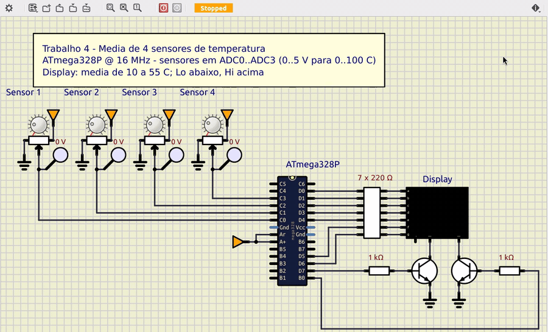
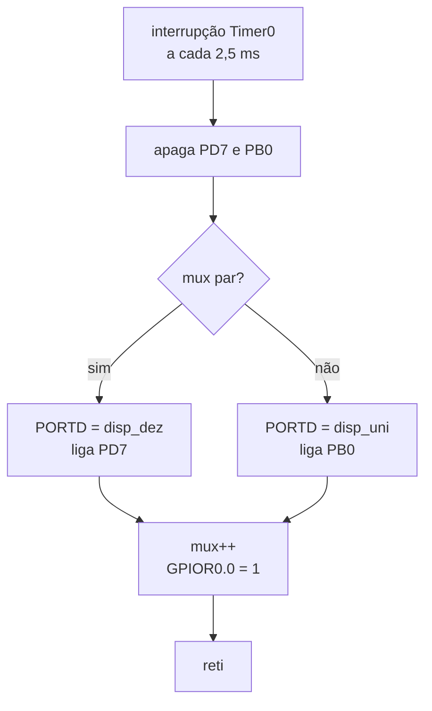
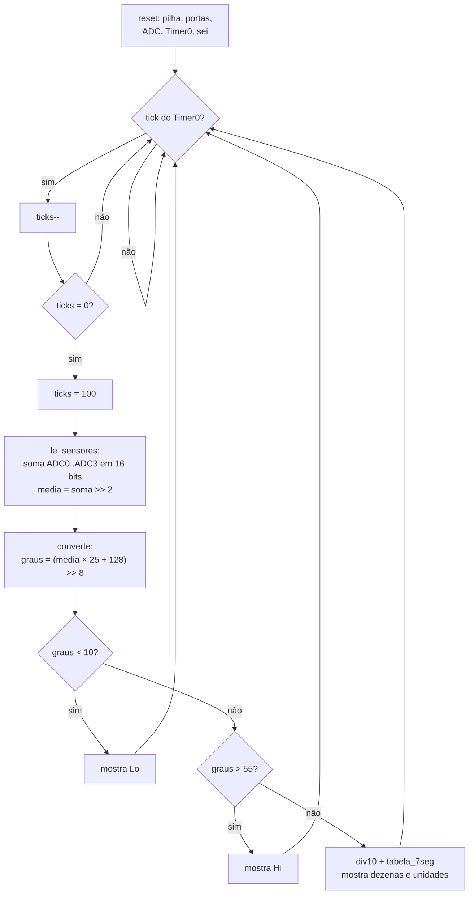
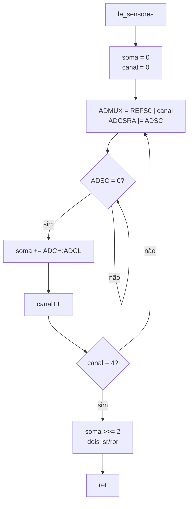

# Média de 4 sensores de temperatura em displays de 7 segmentos — ATmega328P

Trabalho 4 de Microcontroladores (2026/2).

**Aluno:** Bernardo Ivo Goltz — matrícula 202112108

Termômetro escrito em **assembly do ATmega328P**. Quatro sensores de
temperatura ligados nos conversores A/D (ADC0–ADC3) são lidos a cada
250 ms. O programa calcula a média e mostra o valor em °C em **dois
displays de 7 segmentos multiplexados**. A faixa válida é de 10 °C a
55 °C; fora dela o display mostra `Lo` ou `Hi`.

## Objetivo

> Por questão de confiabilidade, 4 sensores de temperatura são ligados nos
> conversores A/D de um microcontrolador. A temperatura mínima é de 10 ºC e
> a máxima é de 55 ºC. Faça a leitura de todos os conversores, calcule a
> média e mostre na saída de 2 displays de 7 segmentos, multiplexados.

## Demonstração



**Vídeo:** [`docs/simulide.mp4`](docs/simulide.mp4) (57 s; o GIF acima é o
mesmo vídeo). Gravação da tela do **SimulIDE 1.1** (Linux) rodando o
circuito [`simulide/termometro.sim1`](simulide/termometro.sim1) com o
binário [`build/termometro.hex`](build/termometro.hex), montado a partir de
[`src/termometro.asm`](src/termometro.asm). Os quatro sensores são
potenciômetros girados com o mouse durante a simulação. Uma ponta de prova
em cada cursor mostra a tensão.

Valores que aparecem no vídeo (tensões lidas nas pontas de prova):

| Sensor 1 | Sensor 2 | Sensor 3 | Sensor 4 | Média (V × 20) | Display |
|---|---|---|---|---|---|
| 1,10 V | 1,20 V | 1,30 V | 1,40 V | 25,00 °C | `25` |
| 3,06 V | 1,20 V | 1,30 V | 1,40 V | 34,80 °C | `35` |
| 3,06 V | 2,94 V | 1,30 V | 1,40 V | 43,50 °C | `43` |
| 3,06 V | 2,94 V | 2,94 V | 1,40 V | 51,70 °C | `52` |
| 3,06 V | 2,94 V | 2,94 V | 2,94 V | 59,40 °C | `Hi` |
| 0,25 V | 2,94 V | 2,94 V | 2,94 V | 45,35 °C | `45` |
| 0,25 V | 0,25 V | 2,94 V | 2,94 V | 31,90 °C | `32` |
| 0,25 V | 0,25 V | 0,25 V | 2,94 V | 18,45 °C | `18` |
| 0,25 V | 0,25 V | 0,25 V | 0,25 V | 5,00 °C | `Lo` |
| 1,00 V | 0,25 V | 0,25 V | 0,25 V | 8,75 °C | `Lo` |
| 1,00 V | 1,56 V | 0,25 V | 0,25 V | 15,30 °C | `15` |
| 1,00 V | 1,56 V | 2,11 V | 0,25 V | 24,60 °C | `25` |
| 1,00 V | 1,56 V | 2,11 V | 2,50 V | 35,85 °C | `36` |

Na linha de 43,50 °C o display mostra `43`: a ponta de prova arredonda a
tensão para 2 casas e o ADC trunca cada leitura. A conta exata com os
códigos do ADC está em [Conversão para °C](#conversão-para-c).

## Hardware

| Componente | Quantidade |
|---|---|
| ATmega328P (16 MHz) ou Arduino Uno | 1 |
| Sensor de temperatura com saída 0–5 V para 0–100 °C | 4 |
| Display de 7 segmentos, catodo comum | 2 |
| Resistor 220 Ω (segmentos) | 7 |
| Resistor 1 kΩ (base dos transistores) | 2 |
| Transistor NPN BC547 | 2 |
| Capacitor 100 nF (AREF) | 1 |

### Sensores e escala

Cada sensor entrega uma tensão proporcional à temperatura:

```
V = T × 50 mV/°C        0 °C → 0 V      10 °C → 0,5 V      55 °C → 2,75 V      100 °C → 5 V
```

Um LM35 (10 mV/°C) com um amplificador não inversor de ganho 5 dá
exatamente essa escala. Na simulação cada sensor é um potenciômetro de
10 kΩ entre GND e 5 V; o cursor faz o papel da saída do sensor.

Com referência de 5 V e 10 bits, 1 código do ADC vale 4,88 mV ≈ 0,1 °C.
A faixa útil (10–55 °C) fica entre os códigos 98 e 568.

### Pinagem

| Pino | Direção | Função |
|---|---|---|
| PC0–PC3 (ADC0–ADC3) | entrada analógica | sensores 1 a 4 |
| AVCC | alimentação | 5 V, referência do ADC |
| AREF | — | 100 nF ao GND (referência interna AVcc) |
| PD0–PD6 | saída | segmentos a–g (nível 1 acende) |
| PD7 | saída | habilita display das dezenas (via Q1) |
| PB0 | saída | habilita display das unidades (via Q2) |

A parte dos displays é a mesma do Trabalho 2: os segmentos dos dois
displays ficam em paralelo em `PORTD` e cada catodo comum é ligado por um
transistor NPN, de modo que só acende o display cujo pino de habilitação
está em 1.

O buffer digital de PC0–PC3 é desligado em `DIDR0`, como o datasheet
recomenda para pinos usados só como entrada analógica.

## Software

O programa tem duas partes: a **interrupção do Timer0**, que multiplexa os
displays e gera a base de tempo, e o **laço principal**, que lê os
sensores, calcula a média e prepara os padrões de segmentos.

### Multiplexação (interrupção do Timer0)

O Timer0 roda em modo CTC com prescaler 256:

```
f = 16 MHz / (256 × (OCR0A + 1)) = 16 000 000 / (256 × 156) ≈ 400,6 Hz  →  T ≈ 2,5 ms
```

A cada interrupção a rotina `isr_timer0` apaga os dois displays, escreve em
`PORTD` o padrão do display da vez (`disp_dez` ou `disp_uni`), liga esse
display e sinaliza um *tick* no bit 0 de `GPIOR0`. Cada display é
atualizado a 200 Hz.



### Laço principal

O laço espera o *tick* testando `GPIOR0` (`sbis`/`rjmp`). A instrução
`sleep` não foi usada porque o SimulIDE 1.1 não a implementa por completo:
o núcleo AVR para e não volta na interrupção. A cada 100 ticks
(100 × 2,496 ms = 249,6 ms) o laço faz uma leitura completa. A primeira
leitura acontece no primeiro tick depois do reset.



### Leitura do ADC

O ADC é configurado com referência AVcc (`REFS0 = 1`), resultado alinhado
à direita e prescaler 128 (16 MHz / 128 = 125 kHz, dentro da faixa de
50–200 kHz para 10 bits). Cada conversão leva 13 ciclos do ADC = 104 µs;
as 4 leituras tomam cerca de 0,4 ms a cada 250 ms.

`le_adc` escreve o canal em `ADMUX`, liga `ADSC` e espera esse bit voltar a
0 (fim da conversão). `ADCSRA` fica fora da faixa de `sbic`/`sbis`, por isso
a espera usa `lds` + `sbrc`. O resultado é lido em `ADCL` e depois em
`ADCH`, nessa ordem, como exige o datasheet. A interrupção do ADC não é
usada.



### Média

As 4 leituras (0–1023 cada) são somadas em 16 bits (`add`/`adc`); a soma
máxima é 4 × 1023 = 4092. Dividir por 4 é deslocar 2 vezes para a direita
(`lsr` no byte alto, `ror` no byte baixo). A média fica entre 0 e 1023,
ainda em códigos do ADC.

### Conversão para °C

A conversão é feita uma única vez, sobre a média:

```
T = media × 100 / 1024        (5 V = 1024 códigos = 100 °C)
  = media × 25 / 256
```

Com arredondamento: `T = (media × 25 + 128) / 256`. Dividir por 256 é pegar
o byte alto do produto, e somar 128 equivale a testar o bit 7 do byte
baixo. A multiplicação usa `mul` (8 × 8 bits) duas vezes:

```
media × 25 = soma_l × 25 + (soma_h × 25) × 256
```

`media × 25` vale no máximo 1023 × 25 = 25 575 e cabe em 16 bits. O
resultado vai de 0 a 100 °C.

Exemplo com os 4 sensores em 20, 30, 40 e 50 °C (1,0 / 1,5 / 2,0 / 2,5 V):

```
códigos: 204 + 307 + 409 + 512 = 1432    média = 1432 >> 2 = 358
358 × 25 = 8950 = 0x22F6    byte alto 0x22 = 34, bit 7 de 0xF6 = 1  →  35 °C
```

### Fora da faixa

| Temperatura média | Display | Segmentos |
|---|---|---|
| abaixo de 10 °C | `Lo` | `L` = 0x38, `o` = 0x5C |
| 10 a 55 °C | valor com 2 dígitos | tabela `tabela_7seg` |
| acima de 55 °C | `Hi` | `H` = 0x76, `i` = 0x04 |

A faixa é testada sobre a média já convertida e arredondada: 9,5 °C já
aparece como `10`, e 55,5 °C já aparece como `Hi`. Em códigos, o display
mostra números para médias de 98 a 568.

### Registradores

| Registrador | Nome | Conteúdo |
|---|---|---|
| r0, r1 | — | resultado do `mul` (r1 volta a 0 depois) |
| r2, r3 | `disp_dez`, `disp_uni` | padrões de segmentos lidos pela interrupção |
| r4 | `mux` | bit 0 escolhe o display da vez |
| r16–r18 | `temp`, `temp2`, `aux` | temporários |
| r19 | `canal` | canal do ADC sendo lido |
| r20, r21 | `soma_l`, `soma_h` | soma das leituras e depois a média |
| r22 | `graus` | temperatura média em °C |
| r23 | `ticks` | ticks até a próxima leitura |
| r24, r25 | `adc_l`, `adc_h` | última conversão |

### Limitações

- **Sensor com defeito não é detectado.** A média usa os 4 canais sempre.
  Um sensor em 0 V com os outros em 40 °C dá média de 30 °C (caso de
  teste "1 sensor fora, media ok"). A faixa 10–55 °C é conferida só na
  média.
- **Sem histerese.** Com ruído real no ADC, uma média na fronteira entre
  dois valores (ex.: 24,5 °C) pode alternar entre `24` e `25` a cada
  250 ms. Na simulação as tensões não têm ruído.
- **Resolução.** O display mostra graus inteiros. A divisão por 4 descarta
  os 2 bits menos significativos da soma (erro menor que 0,1 °C).
- **Atraso.** Uma mudança nos sensores aparece no display em até 250 ms.
- **SimulIDE e AREF.** No SimulIDE 1.1, com `REFS0 = 1` (AVcc), o ADC usa
  a tensão do pino AREF como referência. Com só o AVCC ligado a 5 V o
  firmware leu 0 em todos os canais; ligando o AREF também a 5 V a
  leitura ficou certa. Por isso no circuito simulado AVCC e AREF estão
  ligados juntos em 5 V (o exemplo `m32_adc` do próprio SimulIDE faz o
  mesmo). No hardware real o AREF deve ficar só com o capacitor de 100 nF
  ao GND: ligar uma fonte externa no AREF com a referência interna
  selecionada é proibido pelo datasheet.

## Estrutura do repositório

```
.
├── src/termometro.asm      código-fonte (AVR Assembler)
├── build/termometro.hex    binário montado
├── simulide/
│   └── termometro.sim1     circuito do SimulIDE
├── docs/
│   ├── simulide.mp4        vídeo da simulação no SimulIDE
│   └── simulide.gif        o mesmo vídeo em GIF
└── tools/
    ├── avrsim.py           montador + simulador do ATmega328P (subconjunto)
    ├── testes.py           testes automáticos
    └── gera_simulide.py    gera simulide/termometro.sim1
```

## Como montar e gravar

O fonte segue a sintaxe do AVR Assembler da Microchip e usa
`m328Pdef.inc`.

**Microchip Studio:** criar um projeto *AVR Assembler* para o ATmega328P,
substituir o `main.asm` pelo conteúdo de `src/termometro.asm` e compilar
(F7).

**avra (Linux):**

```sh
avra -I <pasta com m328Pdef.inc> src/termometro.asm
```

**Montador do repositório** (gera o mesmo `build/termometro.hex`, sem
precisar do `m328Pdef.inc`):

```sh
python3 tools/avrsim.py
```

**Gravação em um Arduino Uno** (bootloader):

```sh
avrdude -c arduino -p m328p -P /dev/ttyACM0 -b 115200 -U flash:w:build/termometro.hex:i
```

Os segmentos a e b usam PD0/PD1 (RX/TX). Durante a gravação esses dois
segmentos podem piscar; depois disso o programa não usa a serial. No
Arduino Uno os sensores vão em A0–A3.

## Simulação no SimulIDE

O SimulIDE para Linux está no Flathub:

```sh
flatpak install flathub com.simulide.simulide
flatpak run com.simulide.simulide simulide/termometro.sim1
```

O circuito carrega o firmware de `../build/termometro.hex` (caminho
relativo ao `.sim1`). Clique no botão de energia (vermelho, na barra de
ferramentas) para iniciar a simulação e gire os potenciômetros arrastando
o botão com o mouse. Os potenciômetros começam em 1,1 / 1,2 / 1,3 / 1,4 V
(22, 24, 26 e 28 °C; média 25 °C). O circuito foi gerado por
`python3 tools/gera_simulide.py`.

## Testes automáticos

`tools/avrsim.py` é um montador e simulador mínimo, reaproveitado do
Trabalho 2 e ampliado para este trabalho com o ADC (`ADMUX`, `ADCSRA`,
`ADCL`/`ADCH`, `ADSC`, `ADIF`, interrupção `ADIE`, tempo de conversão de
13 ou 25 ciclos do ADC conforme o prescaler) e a instrução `mul`. Ele monta
o fonte em palavras de máquina (o mesmo `.hex` de `build/`) e executa o
binário decodificando os opcodes. Cada opcode novo foi conferido contra a
codificação do manual de instruções AVR (ex.: `mul r24, r22` = `0x9F86`).
O mesmo `.hex` roda no núcleo AVR do SimulIDE, como mostra o vídeo.
Requer apenas Python 3.

```sh
python3 tools/avrsim.py      # gera build/termometro.hex
python3 tools/testes.py      # roda os testes
```

Os testes colocam tensões nas entradas ADC0–ADC3 (temperatura × 50 mV),
deixam o programa rodar e leem o texto dos displays a partir das escritas
em `PORTB`/`PORTD`. Além dos casos fixos:

- **mudança durante a execução:** começa em 25 °C, muda os sensores com o
  programa rodando e mede quanto tempo o display leva para mostrar `50`;
- **período:** confere a ordem dos canais (0, 1, 2, 3) e o intervalo de
  249,6 ms entre leituras;
- **varredura:** aplica cada um dos 1024 códigos do ADC nos 4 canais e
  compara o display com o modelo `round(codigo × 100 / 1024)`, `Lo` e `Hi`.

Saída de `python3 tools/testes.py`:

```
OK   4 sensores iguais         25  25  25  25 C -> [25] esperado [25]
OK   4 sensores iguais         42  42  42  42 C -> [42] esperado [42]
OK   valores diferentes        20  30  40  50 C -> [35] esperado [35]
OK   valores diferentes        12  18  33  37 C -> [25] esperado [25]
OK   1 sensor fora, media ok    0  40  40  40 C -> [30] esperado [30]
OK   limite inferior           10  10  10  10 C -> [10] esperado [10]
OK   limite superior           55  55  55  55 C -> [55] esperado [55]
OK   media no limite            5  15   8  12 C -> [10] esperado [10]
OK   media no limite           60  50  58  52 C -> [55] esperado [55]
OK   abaixo da faixa            9   9   9   9 C -> [Lo] esperado [Lo]
OK   abaixo da faixa            0   0   0   0 C -> [Lo] esperado [Lo]
OK   acima da faixa            56  56  56  56 C -> [Hi] esperado [Hi]
OK   acima da faixa           100 100 100 100 C -> [Hi] esperado [Hi]
OK   25 -> 50: [25] -> [50] em 8 ms
OK   9 leituras em 2 s, canais 0-1-2-3, intervalo 249.60..249.60 ms
OK   varredura 0..1023: 1024 codigos conferidos

16/16 testes passaram
```

No teste de mudança o atraso medido (8 ms) depende de em que ponto do
ciclo de 250 ms a tensão muda; o teste aceita até 256 ms.

## Código desenvolvido

Arquivo [`src/termometro.asm`](src/termometro.asm):

```asm
;==============================================================================
; Trabalho 4 - Media de 4 sensores de temperatura em 2 displays de 7 segmentos
;
; Microcontrolador : ATmega328P @ 16 MHz
; Montador         : AVR Assembler (Microchip Studio) / avra
;
; Sensores (4 transmissores de temperatura, 0..5 V = 0..100 graus C):
;    ADC0 (PC0) -> sensor 1        ADC2 (PC2) -> sensor 3
;    ADC1 (PC1) -> sensor 2        ADC3 (PC3) -> sensor 4
;    Referencia AVcc (5 V), resolucao de 10 bits.
;
; Displays (catodo comum, multiplexados):
;    PD0..PD6 -> segmentos a..g (ativos em 1)
;    PD7      -> catodo do display das dezenas  (via transistor, ativo em 1)
;    PB0      -> catodo do display das unidades (via transistor, ativo em 1)
;
; Funcionamento:
;    - A cada 250 ms le os 4 canais, soma as leituras em 16 bits e divide
;      por 4 (2 deslocamentos a direita): media de 0 a 1023.
;    - Converte a media em graus: T = (media * 100 + 512) / 1024
;                                   = (media * 25 + 128) / 256
;    - 10..55 graus: mostra o valor. Abaixo de 10: "Lo". Acima de 55: "Hi".
;
; Temporizacao:
;    Timer0 em modo CTC gera interrupcao a cada 2,5 ms (400 Hz).
;    A cada interrupcao um display e aceso (200 Hz por display) e o laco
;    principal recebe um tick; a cada 100 ticks faz uma nova leitura.
;==============================================================================

.include "m328Pdef.inc"

;------------------------------------------------------------------------------
; Constantes
;------------------------------------------------------------------------------
.equ DIG_DEZ    = 7             ; PD7: habilita display das dezenas
.equ DIG_UNI    = 0             ; PB0: habilita display das unidades

.equ N_SENSORES = 4             ; ADC0..ADC3
.equ N_TICKS    = 100           ; 100 x 2,5 ms = 250 ms entre leituras
.equ ESCALA     = 25            ; media * 25 / 256 = media * 100 / 1024

.equ T_MIN      = 10            ; faixa valida, em graus C
.equ T_MAX      = 55

.equ SEG_L      = 0x38          ; d e f
.equ SEG_O      = 0x5C          ; c d e g
.equ SEG_H      = 0x76          ; b c e f g
.equ SEG_I      = 0x04          ; c

;------------------------------------------------------------------------------
; Registradores
;------------------------------------------------------------------------------
.def disp_dez = r2              ; padrao de segmentos do display das dezenas
.def disp_uni = r3              ; padrao de segmentos do display das unidades
.def mux      = r4              ; bit 0 indica qual display acender
.def temp     = r16
.def temp2    = r17
.def aux      = r18
.def canal    = r19             ; canal do ADC sendo lido
.def soma_l   = r20             ; soma das leituras / media (16 bits)
.def soma_h   = r21
.def graus    = r22             ; temperatura media em graus C
.def ticks    = r23             ; ticks ate a proxima leitura
.def adc_l    = r24             ; ultima conversao do ADC
.def adc_h    = r25

;------------------------------------------------------------------------------
; Vetores de interrupcao
;------------------------------------------------------------------------------
.cseg
.org 0x0000
    rjmp reset
.org OC0Aaddr
    rjmp isr_timer0

.org INT_VECTORS_SIZE

;------------------------------------------------------------------------------
; Inicializacao
;------------------------------------------------------------------------------
reset:
    ldi temp, high(RAMEND)      ; pilha no fim da SRAM
    out SPH, temp
    ldi temp, low(RAMEND)
    out SPL, temp

    ser temp                    ; PD0..PD6 segmentos, PD7 dezenas
    out DDRD, temp
    clr temp
    out PORTD, temp             ; displays apagados
    ldi temp, (1<<DIG_UNI)      ; PB0 saida (unidades)
    out DDRB, temp
    clr temp
    out PORTB, temp
    out DDRC, temp              ; PC0..PC3 entradas analogicas, sem pull-up
    out PORTC, temp

    ldi temp, (1<<ADC3D)|(1<<ADC2D)|(1<<ADC1D)|(1<<ADC0D)
    sts DIDR0, temp             ; desliga a entrada digital dos pinos do ADC
    ldi temp, (1<<REFS0)        ; referencia AVcc, canal 0
    sts ADMUX, temp
    ldi temp, (1<<ADEN)|(1<<ADPS2)|(1<<ADPS1)|(1<<ADPS0)
    sts ADCSRA, temp            ; ADC ligado, 16 MHz / 128 = 125 kHz

    ldi temp, (1<<WGM01)        ; Timer0 em modo CTC
    out TCCR0A, temp
    ldi temp, 155               ; 16 MHz / 256 / 156 = 400,6 Hz
    out OCR0A, temp
    ldi temp, (1<<CS02)         ; prescaler 256
    out TCCR0B, temp
    ldi temp, (1<<OCIE0A)       ; habilita interrupcao de comparacao A
    sts TIMSK0, temp

    clr mux
    clr disp_dez                ; displays apagados ate a 1a leitura
    clr disp_uni
    ldi ticks, 1                ; 1a leitura no primeiro tick
    sei

;------------------------------------------------------------------------------
; Laco principal: espera o tick do Timer0 e, a cada N_TICKS ticks, le os
; sensores, calcula a media e atualiza os displays.
;------------------------------------------------------------------------------
laco:
    sbis GPIOR0, 0              ; espera o tick sinalizado pela interrupcao
    rjmp laco
    cbi GPIOR0, 0

    dec ticks
    brne laco
    ldi ticks, N_TICKS

    rcall le_sensores           ; soma = media das 4 leituras (0..1023)
    rcall converte              ; graus = temperatura em graus C (0..100)
    rcall mostra_temperatura
    rjmp laco

;------------------------------------------------------------------------------
; Interrupcao do Timer0 (2,5 ms): multiplexacao dos displays
;------------------------------------------------------------------------------
isr_timer0:
    push temp
    in temp, SREG
    push temp

    cbi PORTD, DIG_DEZ          ; apaga os dois displays antes de trocar
    cbi PORTB, DIG_UNI

    sbrs mux, 0
    rjmp isr_dezenas
    out PORTD, disp_uni         ; bit 7 = 0: dezenas continuam apagadas
    sbi PORTB, DIG_UNI
    rjmp isr_fim
isr_dezenas:
    out PORTD, disp_dez
    sbi PORTD, DIG_DEZ
isr_fim:
    inc mux
    sbi GPIOR0, 0               ; sinaliza o tick para o laco principal

    pop temp
    out SREG, temp
    pop temp
    reti

;------------------------------------------------------------------------------
; le_sensores: le ADC0..ADC3 e deixa a media em soma_h:soma_l
;------------------------------------------------------------------------------
le_sensores:
    clr soma_l
    clr soma_h
    clr canal
le_proximo:
    mov temp, canal
    rcall le_adc                ; adc_h:adc_l = leitura do canal (0..1023)
    add soma_l, adc_l           ; soma em 16 bits: no maximo 4 x 1023 = 4092
    adc soma_h, adc_h
    inc canal
    cpi canal, N_SENSORES
    brne le_proximo

    lsr soma_h                  ; media = soma / 4
    ror soma_l
    lsr soma_h
    ror soma_l
    ret

;------------------------------------------------------------------------------
; le_adc: converte o canal em temp e devolve o resultado em adc_h:adc_l
;------------------------------------------------------------------------------
le_adc:
    ori temp, (1<<REFS0)        ; referencia AVcc + canal
    sts ADMUX, temp
    lds temp, ADCSRA
    ori temp, (1<<ADSC)         ; inicia a conversao
    sts ADCSRA, temp
espera_adc:
    lds temp, ADCSRA            ; ADSC volta a 0 no fim (13 ciclos de ADC)
    sbrc temp, ADSC
    rjmp espera_adc
    lds adc_l, ADCL             ; ADCL antes de ADCH
    lds adc_h, ADCH
    ret

;------------------------------------------------------------------------------
; converte: graus = (media * 25 + 128) / 256, com media em soma_h:soma_l
;   media * 25 = soma_l * 25 + (soma_h * 25) * 256  (cabe em 16 bits)
;   O byte alto do produto e a parte inteira; o bit 7 do byte baixo arredonda.
;------------------------------------------------------------------------------
converte:
    ldi temp, ESCALA
    mul soma_l, temp            ; r1:r0 = soma_l * 25
    mov aux, r0
    mov graus, r1
    mul soma_h, temp            ; r0 = soma_h * 25 (soma_h <= 3)
    add graus, r0
    clr r1
    sbrc aux, 7                 ; fracao >= 0,5: arredonda para cima
    inc graus
    ret

;------------------------------------------------------------------------------
; mostra_temperatura: escreve graus nos buffers dos displays,
;   ou "Lo" / "Hi" fora da faixa T_MIN..T_MAX
;------------------------------------------------------------------------------
mostra_temperatura:
    cpi graus, T_MIN
    brlo mostra_baixo
    cpi graus, T_MAX + 1
    brsh mostra_alto

    mov temp2, graus
    rcall div10                 ; aux = dezenas, temp2 = unidades
    mov temp, aux
    rcall segmentos
    mov disp_dez, temp
    mov temp, temp2
    rcall segmentos
    mov disp_uni, temp
    ret

mostra_baixo:
    ldi temp, SEG_L
    ldi temp2, SEG_O
    rjmp mostra_texto
mostra_alto:
    ldi temp, SEG_H
    ldi temp2, SEG_I
mostra_texto:
    mov disp_dez, temp
    mov disp_uni, temp2
    ret

;------------------------------------------------------------------------------
; div10: temp2 = temp2 mod 10, aux = temp2 / 10
;------------------------------------------------------------------------------
div10:
    clr aux
div10_laco:
    cpi temp2, 10
    brlo div10_fim
    subi temp2, 10
    inc aux
    rjmp div10_laco
div10_fim:
    ret

;------------------------------------------------------------------------------
; segmentos: converte o digito em temp (0..9) no padrao de 7 segmentos
;------------------------------------------------------------------------------
segmentos:
    ldi ZH, high(tabela_7seg*2)
    ldi ZL, low(tabela_7seg*2)
    add ZL, temp
    ldi temp, 0
    adc ZH, temp
    lpm temp, Z
    ret

;------------------------------------------------------------------------------
; Tabela em memoria de programa
;------------------------------------------------------------------------------
tabela_7seg:            ;  0     1     2     3     4     5     6     7     8     9
    .db                  0x3F, 0x06, 0x5B, 0x4F, 0x66, 0x6D, 0x7D, 0x07, 0x7F, 0x6F
```
