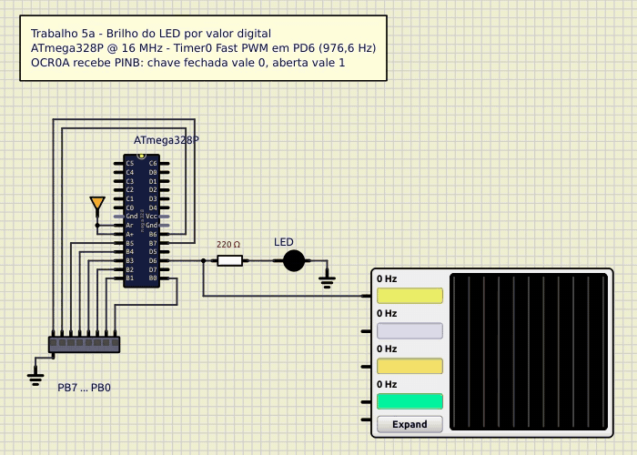

# Brilho de um LED por PWM

Trabalho 5 de Microcontroladores (2026/2) · Bernardo Ivo Goltz (202112108)

PWM no Timer0 do ATmega328P a 16 MHz, simulado no SimulIDE, controla o brilho de um LED. No 5a o duty cycle é um byte lido em oito chaves. No 5b vem do potenciômetro, pelo ADC.

Os trabalhos da disciplina, com circuito, código e simulação, estão em https://github.com/bernardogoltz/microcontroladores



## 5a: brilho por valor digital

[Circuito SimulIDE](simulide/brilho_digital.sim1)

As chaves estão em PB0–PB7, cada uma para o GND, com pull-up interno. Fechada lê 0, aberta lê 1, e a da esquerda é o bit 7. O LED sai em PD6 (OC0A), com resistor de 220 Ω e o catodo no GND. O osciloscópio fica em 200 µs/div. AVcc e AREF em 5 V.

A entrada não cabe na porta D porque PD6 é a saída do PWM. No SimulIDE o cristal externo está desligado, então PB6 e PB7 entram como pino normal. Num Arduino Uno esses dois pinos são do cristal.

O Timer0 está em Fast PWM de 8 bits, modo 3 (`WGM01` e `WGM00` em 1, `WGM02` em 0), TOP = `0xFF`, saída não inversora em OC0A (`COM0A1` = 1) e prescaler 64 (`CS01` e `CS00` em 1).

```
f_PWM = 16 000 000 / (64 × 256) = 976,6 Hz
```

O laço copia `PINB` para `OCR0A`. Com as oito chaves fechadas o LED apaga. Com todas abertas (255) ele fica aceso o período inteiro. Com `OCR0A` em 0 ainda sai um pulso de 4 µs a cada 1,024 ms (0,4%). O LED não acende.

## Código do 5a

[`src/brilho_digital.asm`](src/brilho_digital.asm)

```asm
; Trabalho 5a - Brilho de um LED por PWM com valor digital de 8 bits
;
; Microcontrolador : ATmega328P @ 16 MHz
; Montador         : AVR Assembler (Microchip Studio) / avra
;
; Entrada (8 chaves DIP para o GND, pull-up interno ligado):
;    PB7..PB0 -> chaves 1..8 (chave fechada = bit 0, aberta = bit 1)
;    A porta D nao serve de entrada de 8 bits porque PD6 e a saida PWM.
;    Com o oscilador externo desligado, PB6 e PB7 sao GPIO comuns.
;
; Saida:
;    PD6 (OC0A) -> resistor de 220 R -> LED -> GND
;
; PWM:
;    Timer0 em Fast PWM de 8 bits (modo 3, TOP = 0xFF), saida nao
;    inversora em OC0A, prescaler 64:
;        f = 16 MHz / (64 * 256) = 976,6 Hz
;    Duty = (OCR0A + 1) / 256. OCR0A recebe PINB sem inverter: 0 apaga o
;    LED (sobra um pulso de 4 us por periodo, 0,4 %), 255 deixa o LED
;    aceso o tempo todo.

.include "m328Pdef.inc"

.def temp     = r16

.cseg
.org 0x0000
    rjmp reset

.org INT_VECTORS_SIZE

reset:
    ldi temp, high(RAMEND)      ; pilha no fim da SRAM
    out SPH, temp
    ldi temp, low(RAMEND)
    out SPL, temp

    ser temp                    ; DDRB = 0 desde o reset: PB0..PB7 entradas
    out PORTB, temp             ; pull-up interno nas 8 entradas
    sbi DDRD, PD6               ; PD6 (OC0A) saida

    ldi temp, (1<<COM0A1)|(1<<WGM01)|(1<<WGM00)
    out TCCR0A, temp            ; Fast PWM modo 3, nao inversora em OC0A
    ldi temp, (1<<CS01)|(1<<CS00)
    out TCCR0B, temp            ; WGM02 = 0, prescaler 64

; Copia o valor das chaves para o duty do PWM (OCR0A comeca em 0)
laco:
    in temp, PINB               ; 8 bits das chaves (fechada = 0)
    out OCR0A, temp             ; duty = (PINB + 1) / 256
    rjmp laco
```

## 5b: brilho por potenciômetro

[Circuito SimulIDE](simulide/brilho_adc.sim1)

O cursor de um potenciômetro de 10 kΩ vai em PC0 (ADC0). Os extremos ficam em 5 V e GND. O LED continua em PD6, igual ao 5a. No SimulIDE, AVcc e AREF estão em 5 V. Na placa o AREF não vai nos 5 V: fica só o capacitor de 100 nF para o GND.

O ADC usa referência AVcc (`REFS0` = 1), canal 0, resultado alinhado à esquerda (`ADLAR` = 1) e prescaler 128, o que dá 16 MHz / 128 = 125 kHz, na faixa de 50 a 200 kHz do conversor. A entrada digital de PC0 fica desligada (`ADC0D` em `DIDR0`). Com `ADLAR`, `ADCH` já tem os 8 bits de cima da conversão, e esse byte vai para `OCR0A`. 0 V apaga o LED e 5 V acende.

O PWM é o mesmo do 5a: Fast PWM modo 3, 976,6 Hz.

## Código do 5b

[`src/brilho_adc.asm`](src/brilho_adc.asm)

```asm
; Trabalho 5b - Brilho de um LED por PWM controlado por potenciometro
;
; Microcontrolador : ATmega328P @ 16 MHz
; Montador         : AVR Assembler (Microchip Studio) / avra
;
; Entrada:
;    ADC0 (PC0) -> cursor de um potenciometro de 10 k (extremos em 5 V e GND)
;    Referencia AVcc (5 V), ADC a 16 MHz / 128 = 125 kHz, entrada digital
;    do PC0 desligada (DIDR0). Resultado alinhado a esquerda (ADLAR = 1):
;    ADCH tem os 8 bits mais significativos da conversao de 10 bits.
;
; Saida:
;    PD6 (OC0A) -> resistor de 220 R -> LED -> GND
;
; PWM (o mesmo do 5a):
;    Timer0 em Fast PWM de 8 bits (modo 3, TOP = 0xFF), saida nao
;    inversora em OC0A, prescaler 64:
;        f = 16 MHz / (64 * 256) = 976,6 Hz
;    Duty = (OCR0A + 1) / 256, com OCR0A = ADCH (0 V apaga, 5 V acende).

.include "m328Pdef.inc"

.def temp     = r16

.cseg
.org 0x0000
    rjmp reset

.org INT_VECTORS_SIZE

reset:
    ldi temp, high(RAMEND)      ; pilha no fim da SRAM
    out SPH, temp
    ldi temp, low(RAMEND)
    out SPL, temp

    sbi DDRD, PD6               ; PD6 (OC0A) saida; PC0 ja e entrada sem pull-up

    ldi temp, (1<<ADC0D)
    sts DIDR0, temp             ; desliga a entrada digital do PC0
    ldi temp, (1<<REFS0)|(1<<ADLAR)
    sts ADMUX, temp             ; referencia AVcc, alinhado a esquerda, ADC0
    ldi temp, (1<<ADEN)|(1<<ADPS2)|(1<<ADPS1)|(1<<ADPS0)
    sts ADCSRA, temp            ; ADC ligado, 16 MHz / 128 = 125 kHz

    ldi temp, (1<<COM0A1)|(1<<WGM01)|(1<<WGM00)
    out TCCR0A, temp            ; Fast PWM modo 3, nao inversora em OC0A
    ldi temp, (1<<CS01)|(1<<CS00)
    out TCCR0B, temp            ; WGM02 = 0, prescaler 64

; Converte o ADC0 e copia os 8 bits altos para o duty (OCR0A comeca em 0)
laco:
    lds temp, ADCSRA
    ori temp, (1<<ADSC)         ; inicia uma conversao
    sts ADCSRA, temp
espera_adc:
    lds temp, ADCSRA
    sbrc temp, ADSC             ; ADSC volta a 0 no fim da conversao
    rjmp espera_adc

    lds temp, ADCH              ; 8 bits mais significativos (ADLAR = 1)
    out OCR0A, temp             ; duty = (ADCH + 1) / 256
    rjmp laco
```
