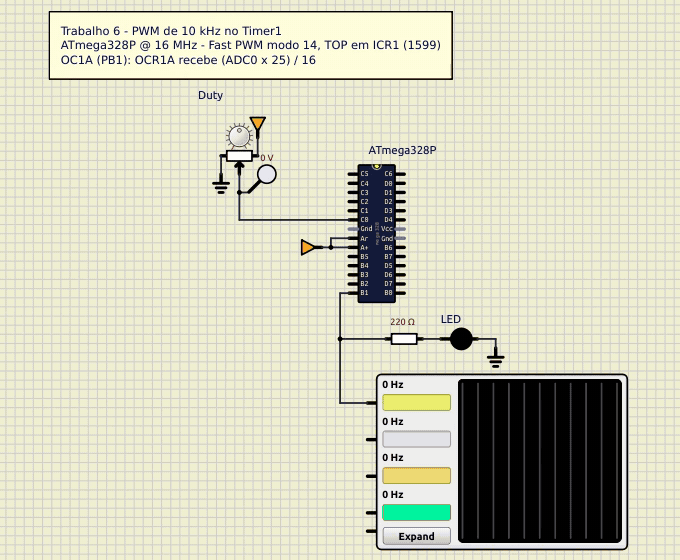

# PWM de 10 kHz com duty cycle pelo potenciômetro

Trabalho 6 de Microcontroladores (2026/2) · Bernardo Ivo Goltz (202112108)

O Timer1 do ATmega328P gera um PWM de 10 kHz. O duty cycle vem de um potenciômetro no ADC0, e a frequência não muda com ele. Clock de 16 MHz, simulado no SimulIDE.

Os trabalhos da disciplina, com circuito, código e simulação, estão em https://github.com/bernardogoltz/microcontroladores



[Circuito SimulIDE](simulide/pwm.sim1)

O potenciômetro é de 10 kΩ. O cursor vai em PC0 (ADC0) e os extremos em 5 V e GND. O LED está em PB1 (OC1A), com resistor de 220 Ω e o catodo no GND. O osciloscópio mede PB1 em 50 µs/div, e o período de 100 µs ocupa duas divisões. AVcc e AREF ficam em 5 V.

Modo 14 do Timer1: Fast PWM com TOP em `ICR1` (`WGM13`, `WGM12` e `WGM11` em 1, `WGM10` em 0), saída não inversora em OC1A (`COM1A1` = 1), prescaler 1 (`CS10` = 1).

```
f_PWM = 16 000 000 / (1599 + 1) = 10 kHz
ICR1  = 16 000 000 / 10 000 - 1 = 1599
```

O modo 14 deixa o TOP em `ICR1` e o `OCR1A` livre para a largura do pulso. A frequência fica em 10 kHz e o potenciômetro só mexe no duty.

`ICR1` e `OCR1A` são de 16 bits. O byte alto é escrito antes do baixo (`ICR1H` antes de `ICR1L`, e o mesmo em `OCR1AH`/`OCR1AL`): a escrita do byte baixo é que grava o par, pelo registrador TEMP. No ADC a ordem é invertida. `ADCL` vem antes de `ADCH`, porque a leitura de `ADCL` segura o resultado até `ADCH`.

A referência é AVcc, canal 0, alinhado à direita, prescaler 128 (16 MHz / 128 = 125 kHz).

```
OCR1A = (ADC × 1600) / 1024 = (ADC × 25) >> 4
duty  = (OCR1A + 1) / 1600
```

ADC 0 vira `OCR1A` 0. O duty fica em 1/1600 (0,06%), um pulso de 62,5 ns, e o LED apaga. ADC 512 vira 800 (50,1%). ADC 1023 vira 1598 (99,9%). O +1 é do Fast PWM. A saída cai quando o contador passa de `OCR1A`, então o pulso tem um passo a mais.

ADC × 25 no máximo dá 25 575, então a multiplicação cabe em 16 bits. São duas `mul` de 8 bits e quatro deslocamentos à direita.

## Código

[`src/pwm.asm`](src/pwm.asm)

```asm
;==============================================================================
; Trabalho 6 - PWM de 10 kHz no Timer1 com duty pelo potenciometro
;
; Microcontrolador : ATmega328P @ 16 MHz
; Montador         : AVR Assembler (Microchip Studio) / avra
;
; Entrada:
;    ADC0 (PC0) -> cursor de um potenciometro de 10 k (extremos em 5 V e GND)
;    Referencia AVcc (5 V), ADC a 16 MHz / 128 = 125 kHz, entrada digital
;    do PC0 desligada (DIDR0), resultado de 10 bits alinhado a direita.
;
; Saida:
;    PB1 (OC1A) -> resistor de 220 R -> LED -> GND (e osciloscopio)
;
; PWM:
;    Timer1 em Fast PWM modo 14 (WGM13..10 = 1110), TOP = ICR1 = 1599,
;    prescaler 1, saida nao inversora em OC1A:
;        f = 16 MHz / (1 * (1599 + 1)) = 10 kHz (periodo de 100 us)
;    A frequencia fica fixa em ICR1; so OCR1A muda com o potenciometro.
;
; Duty:
;    OCR1A = (ADC * 25) >> 4 = (ADC * 1600) / 1024
;    duty = (OCR1A + 1) / 1600: ADC 0 -> OCR1A 0 (pulso de 62,5 ns, LED
;    apagado na pratica), ADC 1023 -> OCR1A 1598 (99,9 %).
;
; Registradores de 16 bits: o byte alto e escrito antes do byte baixo
; (ICR1H/OCR1AH antes de ICR1L/OCR1AL) e ADCL e lido antes de ADCH.
;==============================================================================

.include "m328Pdef.inc"

;------------------------------------------------------------------------------
; Constantes
;------------------------------------------------------------------------------
.equ TOP     = 1599             ; 16 MHz / (1599 + 1) = 10 kHz
.equ ESCALA  = 25               ; ADC * 25 / 16 = ADC * 1600 / 1024

;------------------------------------------------------------------------------
; Registradores
;------------------------------------------------------------------------------
.def temp     = r16
.def adc_l    = r24             ; leitura do ADC / duty (16 bits)
.def adc_h    = r25

;------------------------------------------------------------------------------
; Vetores de interrupcao
;------------------------------------------------------------------------------
.cseg
.org 0x0000
    rjmp reset

.org INT_VECTORS_SIZE

;------------------------------------------------------------------------------
; Inicializacao
;------------------------------------------------------------------------------
reset:
    ldi temp, high(RAMEND)      ; pilha no fim da SRAM
    out SPH, temp
    ldi temp, low(RAMEND)
    out SPL, temp

    ldi temp, (1<<PB1)          ; PB1 (OC1A) saida
    out DDRB, temp
    clr temp
    out PORTB, temp
    out DDRC, temp              ; PC0 entrada analogica, sem pull-up
    out PORTC, temp

    ldi temp, (1<<ADC0D)
    sts DIDR0, temp             ; desliga a entrada digital do PC0
    ldi temp, (1<<REFS0)
    sts ADMUX, temp             ; referencia AVcc, alinhado a direita, ADC0
    ldi temp, (1<<ADEN)|(1<<ADPS2)|(1<<ADPS1)|(1<<ADPS0)
    sts ADCSRA, temp            ; ADC ligado, 16 MHz / 128 = 125 kHz

    ldi temp, high(TOP)         ; ICR1 = 1599: byte alto primeiro
    sts ICR1H, temp
    ldi temp, low(TOP)
    sts ICR1L, temp
    clr temp                    ; OCR1A = 0 ate a primeira conversao
    sts OCR1AH, temp
    sts OCR1AL, temp

    ldi temp, (1<<COM1A1)|(1<<WGM11)
    sts TCCR1A, temp            ; nao inversora em OC1A, WGM11 = 1
    ldi temp, (1<<WGM13)|(1<<WGM12)|(1<<CS10)
    sts TCCR1B, temp            ; WGM13 = WGM12 = 1 (modo 14), prescaler 1

;------------------------------------------------------------------------------
; Laco principal: le o ADC0 e atualiza o duty
;------------------------------------------------------------------------------
laco:
    lds temp, ADCSRA
    ori temp, (1<<ADSC)         ; inicia uma conversao
    sts ADCSRA, temp
espera_adc:
    lds temp, ADCSRA
    sbrc temp, ADSC             ; ADSC volta a 0 no fim da conversao
    rjmp espera_adc

    lds adc_l, ADCL             ; ADCL antes de ADCH
    lds adc_h, ADCH

    rcall calcula_duty          ; adc_h:adc_l = (ADC * 25) >> 4

    sts OCR1AH, adc_h           ; byte alto antes do baixo
    sts OCR1AL, adc_l
    rjmp laco

;------------------------------------------------------------------------------
; calcula_duty: adc_h:adc_l = (adc_h:adc_l * 25) >> 4
;    ADC <= 1023, entao ADC * 25 <= 25575 cabe em 16 bits.
;------------------------------------------------------------------------------
calcula_duty:
    ldi temp, ESCALA
    mul adc_h, temp             ; parte alta: so o byte baixo interessa
    mov adc_h, r0
    mul adc_l, temp             ; parte baixa: r1:r0 = adc_l * 25
    mov adc_l, r0
    add adc_h, r1               ; adc_h:adc_l = ADC * 25
    clr r1

    lsr adc_h                   ; >> 4
    ror adc_l
    lsr adc_h
    ror adc_l
    lsr adc_h
    ror adc_l
    lsr adc_h
    ror adc_l
    ret
```
