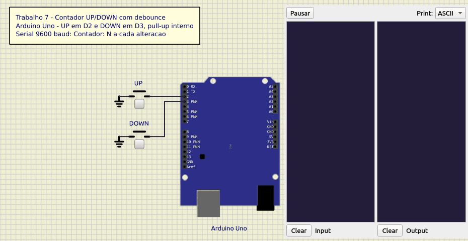

# Contador UP/DOWN com dois botões e debounce

Trabalho 7 de Microcontroladores (2026/2) · Bernardo Ivo Goltz (202112108)

Dois botões num Arduino Uno, com o pull-up interno ligado, mudam um contador que começa em zero. Um soma 1 a cada clique e o outro subtrai 1. O valor sai na serial a cada alteração. O debounce é feito por software, com `millis()`. Simulado no SimulIDE.

Os trabalhos da disciplina, com circuito, código e simulação, estão em https://github.com/bernardogoltz/microcontroladores



[Circuito SimulIDE](simulide/contador.sim1)

O botão UP liga o pino digital 2 (PD2) ao GND, e o DOWN liga o pino 3 (PD3) ao GND. Não há resistor externo: `pinMode(pino, INPUT_PULLUP)` liga o pull-up interno do ATmega328P (20 kΩ a 50 kΩ). Solto, o pino lê `HIGH`. Pressionado, lê `LOW`. A serial usa os pinos 0 e 1, que no Uno vão para a USB.

A serial está a 9600 baud. Ao ligar sai `Contador: 0`, e depois uma linha a cada alteração:

```
Contador: 0
Contador: 1
Contador: 2
Contador: 1
```

O contador é um `int` e pode ficar negativo.

## Debounce

Ao fechar ou abrir, o contato do botão oscila por alguns milissegundos. Sem filtro, cada oscilação seria lida como um clique. Cada botão guarda a última leitura do pino e o instante, em `millis()`, em que ela mudou. Uma leitura nova só é aceita depois de ficar 50 ms sem mudar. Toda oscilação reinicia essa espera.

O clique conta na passagem aceita de `HIGH` para `LOW`, ao pressionar. Segurar conta uma vez e soltar não conta. A espera não usa `delay()`, então os dois botões são lidos em todas as passagens do `loop()`.

A conta `t - b.mudou` é feita em `unsigned long`. Quando `millis()` volta a zero, após 49,7 dias, a diferença continua certa.

## Compilação

O sketch está em [`src/contador/contador.ino`](src/contador/contador.ino). A pasta tem o mesmo nome do sketch, como a Arduino IDE exige. Na IDE: abrir o arquivo, escolher a placa Arduino Uno e carregar. Pelo `arduino-cli`:

```
arduino-cli compile --fqbn arduino:avr:uno --output-dir build src/contador
arduino-cli upload -p /dev/ttyACM0 --fqbn arduino:avr:uno src/contador
```

O circuito do SimulIDE carrega `../build/contador.ino.hex`, o arquivo que o primeiro comando gera.

## Código

[`src/contador/contador.ino`](src/contador/contador.ino)

```cpp
// Trabalho 7 - Contador UP/DOWN com dois botoes, pull-up interno e debounce
//
// Placa        : Arduino Uno (ATmega328P @ 16 MHz)
// Compilador   : Arduino IDE / arduino-cli (core arduino:avr)
//
// Entradas (botoes para o GND, pull-up interno ligado):
//    D2 (PD2) -> botao UP   (solto = HIGH, pressionado = LOW)
//    D3 (PD3) -> botao DOWN (solto = HIGH, pressionado = LOW)
//
// Saida:
//    Serial a 9600 baud (D0 RX, D1 TX): "Contador: N" no inicio e a cada
//    alteracao do contador.
//
// Debounce:
//    Cada botao guarda a ultima leitura do pino e o instante (millis) em que
//    ela mudou. Uma leitura so e aceita depois de ficar DEBOUNCE_MS sem mudar.
//    O clique conta na transicao aceita de HIGH para LOW (ao pressionar).
//    Segurar o botao conta uma vez; soltar nao conta.

const uint8_t PINO_UP = 2;
const uint8_t PINO_DOWN = 3;
const unsigned long DEBOUNCE_MS = 50;

struct Botao {
  uint8_t pino;
  uint8_t estavel;          // estado aceito depois do debounce
  uint8_t leitura;          // ultima leitura bruta do pino
  unsigned long mudou;      // millis() da ultima mudanca da leitura
};

Botao up = {PINO_UP, HIGH, HIGH, 0};
Botao down = {PINO_DOWN, HIGH, HIGH, 0};
int contador = 0;

void iniciaBotao(Botao &b) {
  pinMode(b.pino, INPUT_PULLUP);
  b.leitura = digitalRead(b.pino);
  b.estavel = b.leitura;    // botao ja pressionado no reset nao conta
  b.mudou = millis();
}

// Retorna true uma vez por clique (borda de descida ja filtrada).
bool clicou(Botao &b) {
  uint8_t agora = digitalRead(b.pino);
  unsigned long t = millis();

  if (agora != b.leitura) {             // pino mudou: reinicia a espera
    b.leitura = agora;
    b.mudou = t;
    return false;
  }
  if (agora != b.estavel && t - b.mudou >= DEBOUNCE_MS) {
    b.estavel = agora;                  // ficou DEBOUNCE_MS sem mudar
    return agora == LOW;                // pressionou (soltar nao conta)
  }
  return false;
}

void mostraContador() {
  Serial.print("Contador: ");
  Serial.println(contador);
}

void setup() {
  Serial.begin(9600);
  iniciaBotao(up);
  iniciaBotao(down);
  mostraContador();                     // valor inicial: 0
}

void loop() {
  if (clicou(up)) {
    contador++;
    mostraContador();
  }
  if (clicou(down)) {
    contador--;
    mostraContador();
  }
}
```
